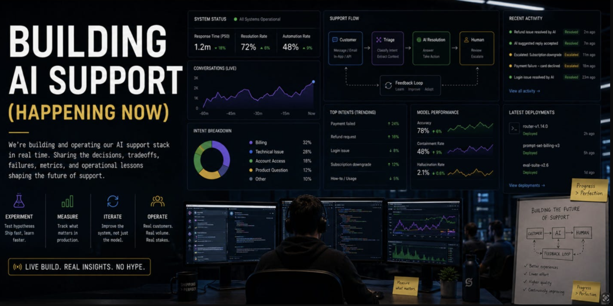

# The Support Machine

*How to Deploy AI in Customer Support Without Breaking Trust*, by Assaf Barnir.

A free book and practical AI skills for support leaders at API, developer-tool, and B2B companies, and the executives who work with them.

**v0.3 is the complete review edition:** 29 chapters, eight appendices, and two companion skills. The appendices collect every chapter field note, dated observations, the relevant repositories, 80 practical prompts, and sources by chapter. The previous public edition is v0.2. This branch prepares the release; it does not change the public website until merged and deployed.

## Read and review

- [Complete reading copy for Google Docs](review/the-support-machine-v0.3-reading-copy.docx) — plain chapter titles; discuss edits by chapter and passage in chat.
- [Chapter reading guide](review/v0.3-reading-guide.md)
- [All manuscript additions and deletions](https://github.com/assafbar2/the-support-machine/pull/2/files#diff-84e14219a34f7db72ce51facde9568b51bc20a4d8ff5c9f58525fae1834b34b6)
- [Complete book in Markdown](skills/the-support-machine/references/book.md)
- [Complete text for review](review/v0.3-complete-text.md)
- [PDF](docs/the-support-machine-v0.3.pdf)
- [Word manuscript](manuscript/The%20Support%20Machine%20-%20manuscript%20v0.3.docx)
- [Notes for the new version](release-notes/v0.3.md)
- [Full scope and chapter locations](release-notes/v0.3-coverage.md)
- [Changelog](CHANGELOG.md)
- [Online book](https://assafbar2.github.io/the-support-machine/book.html) — the public site shows the deployed edition.

Returning readers should start with the version notes. The new material covers organizational NIMBY behavior, continuing evaluation, build versus buy, customer agents, action receipts, recovery, customer promises, honest metrics, and support engineers shipping improvements.

This edition builds on more use cases I've seen, discussed, researched, and worked through in collaboration with humans and AI since the first version was released.

Fictional scenarios and prototypes are labeled. Vendor capabilities are a dated snapshot, not a guarantee of access or results.

The Reader's Note celebrates my appearance on **The Prompt Room, Episode 4**: [watch on YouTube](https://www.youtube.com/watch?v=JxJb4FDqWdI) or [listen on Spotify](https://open.spotify.com/episode/6x73nZKsh9y1VIw46yCW5q). The full supplied transcript informs five chapters and a dated field note.

## Previous edition

v0.2 remains available as [PDF](docs/the-support-machine-v0.2.pdf), [Word](manuscript/The%20Support%20Machine%20-%20manuscript%20v0.2.docx), [Markdown](docs/editions/v0.2/book.md), and [archived HTML](docs/editions/v0.2/book.html). Original PDF, DOCX, and Markdown checksums are retained in the archive. The repository had no v1.0 edition; this release follows its established version sequence.

## Use the skills

Start with [Appendix G](skills/the-support-machine/references/book.md#appendix-g-talk-to-the-book): installation comes first, followed by 80 prompts.

**The Support Machine** includes the full v0.3 book, its podcast additions, all eight appendices, and fourteen reusable templates. [Download the ZIP](docs/downloads/the-support-machine.zip) or the [.skill package](docs/downloads/the-support-machine.skill).

**Support AI Evals** focuses on delayed outcome checks, calibrated review, failure analysis, and knowledge releases. Its local cohort calculator uses Python's standard library and explicit reviewed input. It does not connect to Intercom or infer success from silence.

**Claude:** Upload the ZIP through Customize → Skills → + → Create skill → Upload a skill, then enable it. Code execution and file creation must be available under your account's policy. [Official guide](https://support.claude.com/en/articles/12512180-use-skills-in-claude).

**Codex:** Ask the built-in installer:

```text
$skill-installer Install skills/the-support-machine from GitHub repository assafbar2/the-support-machine, ref codex/support-machine-v0.3.
```

Invoke `$the-support-machine` with a task. Restart Codex if it does not appear. Manual installation uses the complete folder under `~/.agents/skills/`. [Official guide](https://learn.chatgpt.com/docs/build-skills).

Verify the loaded edition is v0.3 and that the skill can read Chapter 28 and its build-versus-buy template. Reinstall or upload the new package after an edition change; installed copies do not automatically follow GitHub. Keep company-specific notes separately.

The optional [Support AI Evals ZIP](docs/downloads/support-ai-evals.zip) installs separately. Both skills work independently. After installation, describe your situation or ask a question. The Support Machine skill reads the relevant chapters from its bundled book; readers supply their own context.

Try:

- “Use The Support Machine to compare buying, extending, and building our support agent.”
- “Use The Support Machine to rehearse recovery from a credit whose result is unknown.”
- “Use Support AI Evals to analyze our seven-day cohort and explain what the data cannot establish.”

## Maintain the edition

The formatted DOCX is the canonical manuscript. Markdown, HTML, downloads, and the complete review text are derived from it. For a large text revision, the importer can convert a complete Markdown working draft into the DOCX; that draft is not a second canonical source.

See [CONTRIBUTING.md](CONTRIBUTING.md) for export, rendering, validation, and release steps. [edition.json](edition.json) holds the version metadata. Website CSS is maintained directly.

## Shadow Run field sheet

[Download the one-page field sheet](docs/shadow-run/Shadow-Run-Field-Sheet-v0.13.pdf). The older talk handout remains available; the book and updated scorecard contain the expanded release-gate guidance.



## License and contact

Book text and book-format outputs: [CC BY 4.0](LICENSE-MANUSCRIPT.md). Skills, templates, scripts, and repository documentation: [MIT](LICENSE-SKILL.md). See [LICENSE.md](LICENSE.md).

[Website](https://barnir.co) · [Email](mailto:assafbar@gmail.com)

This is a personal project, not an official Sentry support channel.
