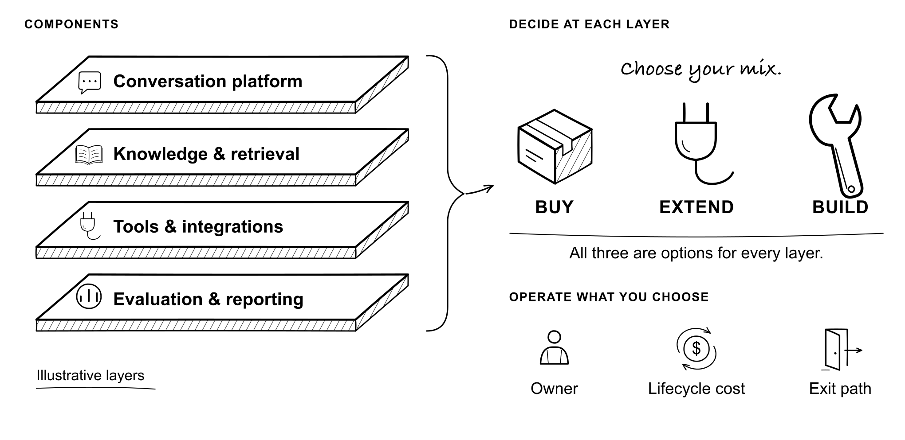

# The Support Machine

### Second Edition

*How to Deploy AI in Customer Support Without Breaking Trust*

By **Assaf Barnir**

A free field guide for support leaders at API, developer-tool, and B2B companies—and the executives who work with them. From choosing the system and preparing the team to verifying outcomes and improving the service after launch.

**[Read the Second Edition](https://assafbar2.github.io/the-support-machine/book.html)** · **[Download the PDF](https://assafbar2.github.io/the-support-machine/the-support-machine-second-edition.pdf)** · [Book home](https://assafbar2.github.io/the-support-machine/)

29 chapters · 8 appendices · 10 illustrations · 80 practical prompts · 2 companion AI skills



## What's new in the Second Edition

This edition builds on more use cases I've seen, discussed, researched, and worked through with humans and AI since the first edition.

- **Six new chapters:** organizational resistance, build versus buy, customer agents, action receipts, recovery, and continuing evaluation.
- **A stronger operating model:** customer promises, the 16% calculation, support teams shipping improvements, and repeatable release gates.
- **More ways to apply it:** all field notes in one appendix, related projects, fourteen templates, skill installation, and 80 prompts.
- **Ten new illustrations** and insights from my conversation on **The Prompt Room**.

[Notes for returning readers](https://assafbar2.github.io/the-support-machine/notes.html) · [Chapter reading map](release-notes/v0.3-coverage.md) · [All ten illustrations](https://assafbar2.github.io/the-support-machine/illustrations/)

## Choose your format

| Read or use | Link |
|---|---|
| Complete online book | [Read in your browser](https://assafbar2.github.io/the-support-machine/book.html) |
| PDF | [Download the Second Edition](https://assafbar2.github.io/the-support-machine/the-support-machine-second-edition.pdf) |
| Editable document | [Download DOCX](https://assafbar2.github.io/the-support-machine/downloads/the-support-machine-second-edition.docx) |
| Markdown | [Read the text](skills/the-support-machine/references/book.md) · [Download with images](https://assafbar2.github.io/the-support-machine/downloads/the-support-machine-second-edition-markdown.zip) |
| AI skills | [Installation and examples](https://assafbar2.github.io/the-support-machine/skill.html) |

## Work with the book

[Appendix G](https://assafbar2.github.io/the-support-machine/book.html#appendix-g-talk-to-the-book) starts with installation, verification, and updates, followed by 80 prompts. Install the book once; your assistant can read the relevant chapters and templates when you bring it a question or decision.

**The Support Machine** includes the complete Second Edition and fourteen templates. [Download the ZIP](https://assafbar2.github.io/the-support-machine/downloads/the-support-machine.zip) or [.skill package](https://assafbar2.github.io/the-support-machine/downloads/the-support-machine.skill).

**Claude:** Upload the ZIP through Customize → Skills → + → Create skill → Upload a skill, then enable it. Code execution and file creation must be available under your account's policy. [Official guide](https://support.claude.com/en/articles/12512180-use-skills-in-claude).

**Codex:** Ask the built-in installer:

```text
$skill-installer Install skills/the-support-machine from GitHub repository assafbar2/the-support-machine, ref main.
```

Invoke `$the-support-machine` with a task. Restart Codex if it does not appear. Verify that the loaded book identifies itself as the Second Edition and includes Chapter 28 on continuing evaluation. Reinstall when a new edition arrives; installed copies do not automatically follow GitHub. [Official guide](https://learn.chatgpt.com/docs/build-skills).

The optional [Support AI Evals skill](https://assafbar2.github.io/the-support-machine/downloads/support-ai-evals.zip) provides a focused evaluation workflow and local cohort calculator. It installs separately and does not connect to a helpdesk.

## Hear the conversation

I joined **The Prompt Room, Episode 4** to discuss reducing customer pain and how support work is changing. That conversation informs several chapters. [Watch on YouTube](https://www.youtube.com/watch?v=JxJb4FDqWdI) or [listen on Spotify](https://open.spotify.com/episode/6x73nZKsh9y1VIw46yCW5q).

## First Edition and companion material

The [First Edition remains available](https://assafbar2.github.io/the-support-machine/editions.html) in its original formats. The [Shadow Run field sheet](docs/shadow-run/Shadow-Run-Field-Sheet-v0.13.pdf) accompanies the earlier talk.

[Edition highlights](CHANGELOG.md) · [Contributing and publishing](CONTRIBUTING.md)

## Author and license

This is my personal project. The judgments and recommendations are mine; I do not speak for Sentry. This repository is not an official Sentry support channel.

Book text, illustrations, and book formats: [CC BY 4.0](LICENSE-MANUSCRIPT.md). Skills, templates, scripts, and repository documentation: [MIT](LICENSE-SKILL.md).

[About Assaf](https://www.barnir.co/) · [Email](mailto:assafbar@gmail.com)
