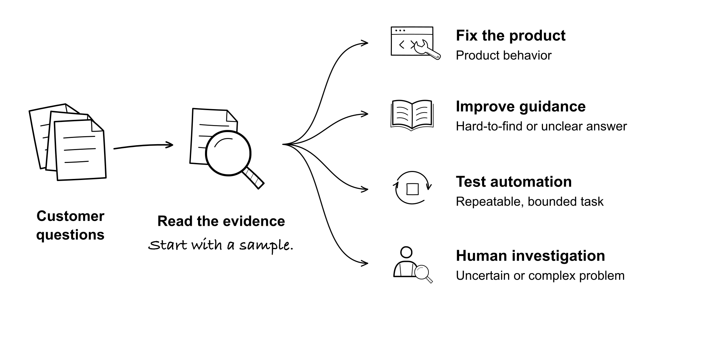
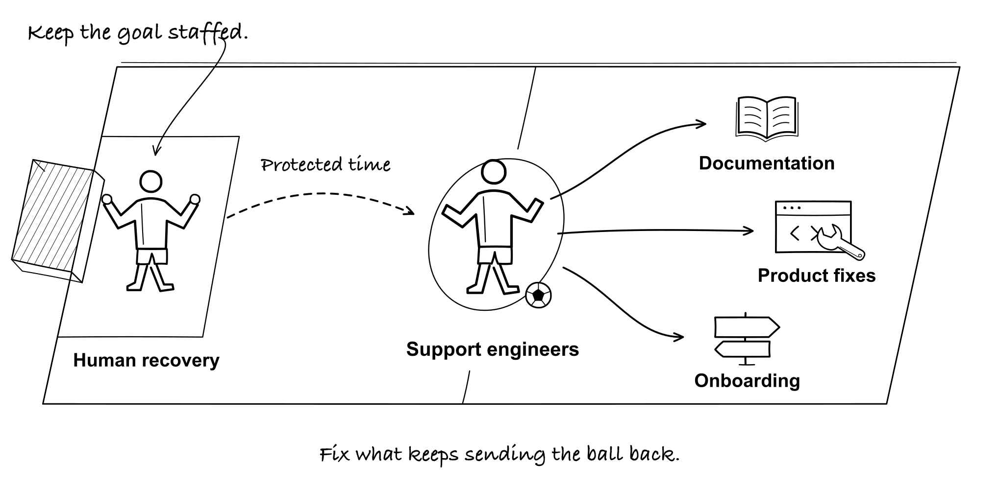
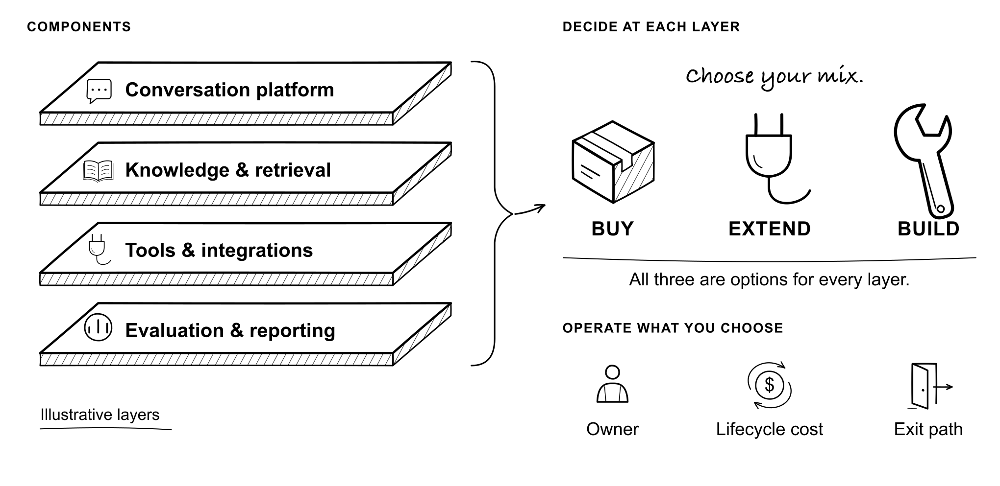
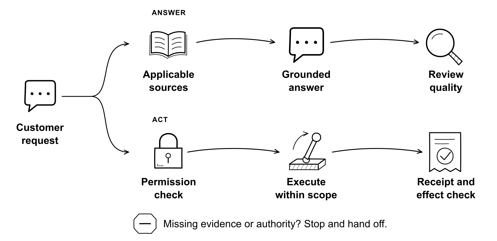
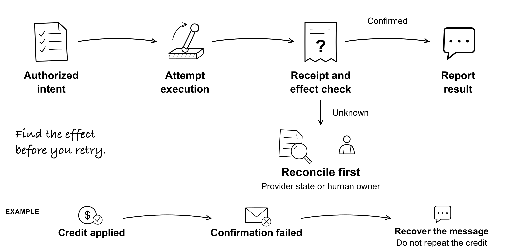
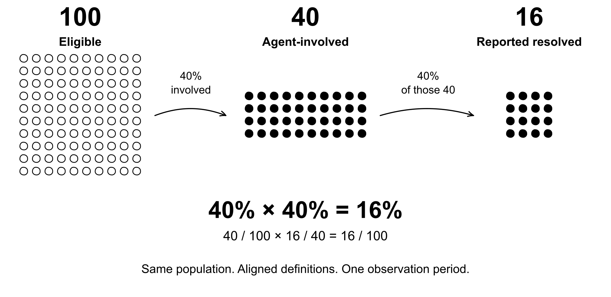
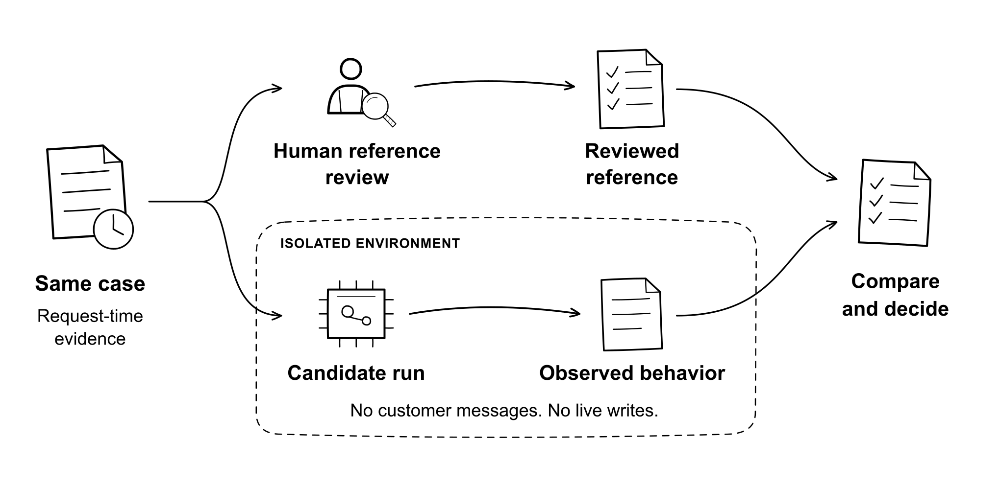
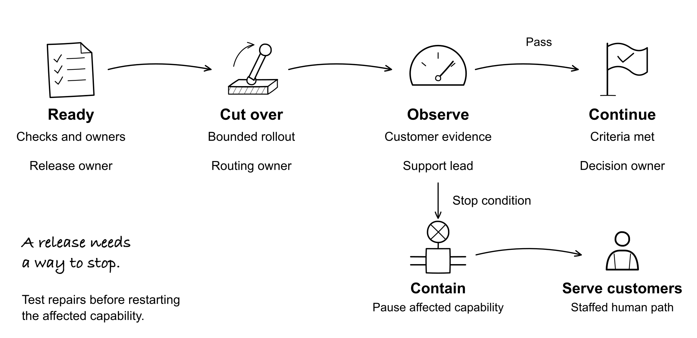
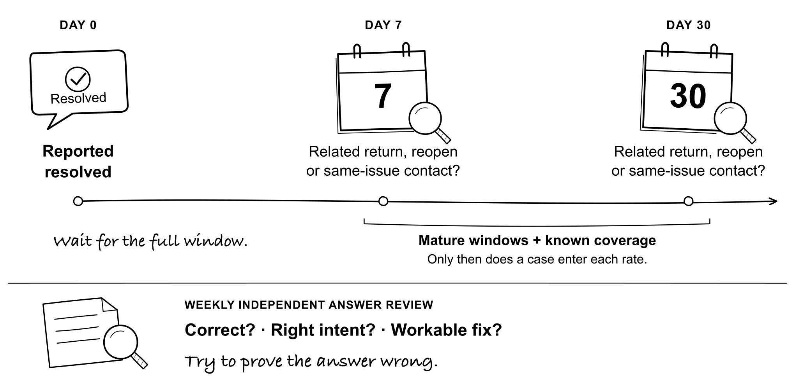
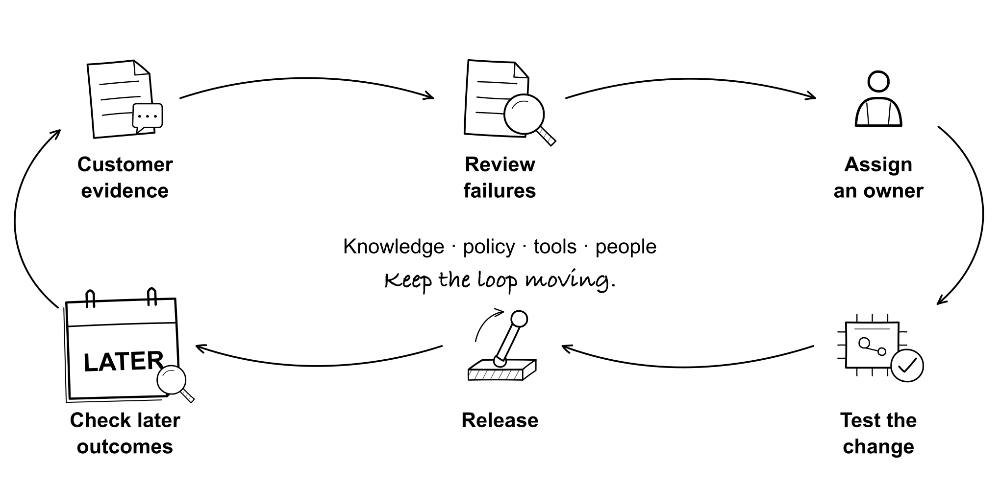

# The Support Machine

> Markdown export of the manuscript. The canonical formatted source is maintained in `manuscript/`.

How to Deploy and Run AI Customer Support Without Breaking Trust

Assaf Barnir

Second Edition · November 1, 2026

## Notes for the Second Edition

This edition builds on more use cases I've seen, discussed, researched, and worked through in collaboration with humans and AI since the first edition was released.

This edition moves the book beyond the launch room. The original migration story remains, but more of the work now happens after the first answer: verifying the result, recovering when it fails, and changing the system without teaching it a new mistake.

If you read the first edition, there are six new chapters and a lot of rewriting. Here's where to return.

| **If you care about** | **Read** |
| --- | --- |
| Organizational resistance | Chapter 5: four fictional NIMBY cases, a self-check, and the objection that correctly stops an unsafe rollout |
| Build versus buy | Chapters 7 and 8: current platforms, component ownership, lifecycle cost, connector retirement, and exit risk |
| Agents talking to agents | Chapters 15 and 16: trustworthy identity, and proof that an action actually happened |
| Promises and measurement | Chapters 17 and 18: commitments to the customer's working result, the 40% × 40% = 16% calculation, and visible metric definitions |
| People who ship improvements | Chapters 6, 19, and 29: protected time, training, review authority, and customer impact |
| Release and recovery | Chapters 20, 22, and 27: decisive migration with a tested fallback, a repeatable shadow gate, and accountable recovery |
| Evaluation after launch | Chapter 28: seven- and thirty-day outcome checks, calibrated review, and a rubric for correct-but-useless answers |

I also got some things wrong. This printing revisits first-edition claims in Chapters 8, 9, and 20: when to build, what a vendor questionnaire proves, and why a migration needs a fallback. I've made the writing more conversational and moved the full prompt library and detailed evaluation methods into the companion skills.

My appearance on The Prompt Room adds a personal self-check in Chapter 5, continuity across the sales handoff in Chapter 17, earlier customer signals in Chapter 18, debugging judgment in Chapter 19, and welcomed human handoffs in Chapter 23. The Reader's Note links to the episode.

At the back: Appendix E indexes the field notes and keeps nine dated observations. Appendix F connects the repositories to the chapters. Appendix G shows you how to install the book as a skill, with ten prompts to start. Appendix H groups the research and product links by chapter, so the story doesn't stop for citations. Ten illustrations sit beside the discussions they explain: the six operating gates, the 16% calculation, delayed evaluation, action recovery, and the midfield model.

The vendor discussion is a snapshot checked on November 1, 2026. Announced, early-access, generally available, and enabled in your workspace are different states. For Fin (formerly Intercom), the Operator, Skills, audiences, and customer-success direction widen the questions to ask. They don't remove the need to test your own configuration. Pylon, Salesforce, and Plain provide useful alternative approaches to examine.

Personal accounts, fictional teaching cases, prototype demonstrations, and recommended practices are identified throughout the book.

The first edition remains available in the [edition archive](https://assafbar2.github.io/the-support-machine/editions.html), including its PDF, DOCX, and Markdown.

## Reader's Note

This book began as a live field journal from inside a real AI support migration. No polished case study after the fact. I wanted to capture the work while it was still alive: the risks unresolved, the machine not yet trusted, every confident sentence one bad week away from becoming a cautionary tale.

This is my personal field guide, shaped by work at Sentry and elsewhere. The judgments and recommendations are mine; I am not speaking for Sentry or describing its official policies. The migration scenes reflect my experience at the time. The playbooks describe how I recommend running the work.

The argument fits on a sticky note. AI support is an operating model migration. The chatbot is the smallest part of it.

A chatbot answers. A support machine routes, reasons, retrieves, escalates, measures, learns, and changes the work humans do around it. That makes the launch more powerful, and more dangerous, than most teams admit.

The metaphors in this book are intentional. The Rubicon, the machine, the goalkeeper, the wizard, the tollbooth, the shadow run, and zero hour are not decorations. They are operating language for decisions teams usually bury under vendor decks and roadmap slides.

### Hear the conversation

I joined The Prompt Room, from Thunai, for Episode 4 on October 13, 2026, to talk about reducing customer pain at the source. We covered how engineering led me into Support, why the goalkeeper needs to move into midfield, and what changes when the team can spend more time removing customer problems.

We also talked about my early arrogance as an engineer, the context customers lose between teams, and why asking for a human should be welcome. I'm glad to share this conversation alongside the book.

[Watch Episode 4 on YouTube](https://www.youtube.com/watch?v=JxJb4FDqWdI) or [listen on Spotify](https://open.spotify.com/episode/6x73nZKsh9y1VIw46yCW5q).

## Who This Book Is For

This book is for support leaders, CX operators, support engineers, customer success leaders, technical founders, and executives who know the AI demo is easy and the launch is hard.

It is especially for B2B SaaS teams whose customers are technical enough to notice when the machine is bluffing.

It is not for people looking for a generic tour of AI trends. It is not a model-training manual. It is a field guide for operators who have to protect trust while changing the physics of the queue.

## How To Use This Book

Read it once as a story. Then read it again as a migration plan.

The story matters because AI support is full of false confidence. If you only read checklists, the work looks cleaner than it is. If you only read the narrative, the work feels more mysterious than it is. The useful truth sits between the two: operators need a narrative strong enough to align the company and artifacts sharp enough to survive launch day.

Each part of the book moves through a different layer of the migration. Part I diagnoses the friction. Part II walks through the market and the minefield. Part III designs the machine. Part IV launches it. Part V turns launch into an operating model.

The field notes are deliberately blunt. They are the lines you should be able to repeat in a planning meeting, vendor review, launch room, or executive update. Each one turns the chapter’s story into an operating lesson to carry forward. Appendix E indexes them by chapter and keeps the dated observations behind this edition.

Appendix F connects the projects to the chapters. Appendix G shows you how to install the book as a skill and gives you ten prompts to start. The full library of 80 ships with the skill. Research and product links are collected in [Appendix H](#appendix-h-sources-and-further-reading), organized by chapter, so you can check the sources when you need them.

## The Operating Map

The book uses six gates. A team that cannot pass a gate should not pretend it is ready for the next one.

Gate 1: Diagnose the queue. Know what customers ask, what they cannot find, and which questions are truly solvable.

Gate 2: Choose the machine. Separate real systems from demos, wrappers, hidden humans, and vendor hand-waving.

Gate 3: Design the guardrails. Decide what the machine can know, say, do, and stop doing.

Gate 4: Shadow-run the machine. Test it against real cases before customers can feel the blast radius.

Gate 5: Launch with direct accountability. Every lane needs a named owner. No orphaned decisions.

Gate 6: Operate the living system. Review failures, ship fixes, update knowledge, and promote humans into system work.

## Contents

**Part I: The Friction**

- [1. The Friction Point](#1-the-friction-point)

- [2. Do We Actually Need AI, or Just Better Operations?](#2-do-we-actually-need-ai-or-just-better-operations)

- [3. Data Gathering: Building the Case Beyond "Vibes"](#3-data-gathering-building-the-case-beyond-vibes)

- [4. "We Already Have AI" and Other Logical Traps](#4-we-already-have-ai-and-other-logical-traps)

- [5. AI NIMBYs: Progress, Just Not in My Backyard](#5-ai-nimbys-progress-just-not-in-my-backyard)

- [6. The Goalkeeper Fallacy](#6-the-goalkeeper-fallacy)

**Part II: The Market and the Minefield**

- [7. The Landscape: Everyone Is an AI Company Now](#7-the-landscape-everyone-is-an-ai-company-now)

- [8. Build vs. Buy, Again](#8-build-vs-buy-again)

- [9. The Wizard of Oz](#9-the-wizard-of-oz)

- [10. The Security Gauntlet](#10-the-security-gauntlet)

- [11. The Paper Trail of a Vision](#11-the-paper-trail-of-a-vision)

- [12. The Product Veto](#12-the-product-veto)

**Part III: The Machine**

- [13. My Dream AI Architecture](#13-my-dream-ai-architecture)

- [14. The Read-Write Rubicon](#14-the-read-write-rubicon)

- [15. When the Customer Is a Bot](#15-when-the-customer-is-a-bot)

- [16. Did the Action Actually Happen?](#16-did-the-action-actually-happen)

- [17. The Support-to-GTM Feedback Loop](#17-the-support-to-gtm-feedback-loop)

- [18. CSAT and Other Comfort Metrics](#18-csat-and-other-comfort-metrics)

- [19. The Promotion](#19-the-promotion)

**Part IV: The Migration**

- [20. Burn the Ships. Keep a Lifeboat.](#20-burn-the-ships-keep-a-lifeboat)

- [21. When Your AI Implementation Partner Is Just a Tollbooth](#21-when-your-ai-implementation-partner-is-just-a-tollbooth)

- [22. The Shadow Run](#22-the-shadow-run)

- [23. The B2D2B AI Rollout](#23-the-b2d2b-ai-rollout)

- [24. The Launch Inventory](#24-the-launch-inventory)

- [25. Zero Hour](#25-zero-hour)

**Part V: The Operating Model**

- [26. The First 30 Days](#26-the-first-30-days)

- [27. When the Agent Gets It Wrong](#27-when-the-agent-gets-it-wrong)

- [28. Evaluating AI: The Work Is Never Done](#28-evaluating-ai-the-work-is-never-done)

- [29. The AI Support Operating Model](#29-the-ai-support-operating-model)

- [Appendix A: Vendor and Build Scorecard](#appendix-a-vendor-and-build-scorecard)

- [Appendix B: Shadow Run and Change Release Record](#appendix-b-shadow-run-and-change-release-record)

- [Appendix C: Launch and Recovery Runbook](#appendix-c-launch-and-recovery-runbook)

- [Appendix D: Glossary](#appendix-d-glossary)

- [Appendix E: Dated Observations](#appendix-e-dated-observations)

- [Appendix F: Repositories Behind the Book](#appendix-f-repositories-behind-the-book)

- [Appendix G: Talk to the Book](#appendix-g-talk-to-the-book)

- [Appendix H: Sources and Further Reading](#appendix-h-sources-and-further-reading)

## Introduction: This Is Not a Chatbot Project

There is a dangerous sentence hiding inside almost every AI support project: "Let's add a bot." It sounds small. It sounds practical. It sounds like a feature. It is usually the first sign that the team is underestimating the migration.

A bot is a surface. A support machine is an operating model. The difference matters because customers do not experience your org chart. They experience the answer, the escalation, the handoff, the policy, the missing document, the broken workflow, the tone, the timing, and the confidence of the system when it says it knows what to do.

If the machine is wrong, trust burns faster than time is saved. If the machine is right, the support team stops being a queue-clearing function and becomes the architecture team for customer knowledge.

That is the real promise of AI support: not fewer humans, but better-shaped human work. The machine should absorb repetition, expose product gaps, route ambiguity, and make the organization smarter every time a customer gets stuck.

This book follows one live migration from friction to zero hour. It keeps the mess in the frame because the mess is the point. The vendor demo is not the hard part. The hard part is deciding what the machine is allowed to know, what it is allowed to do, when it must stop, who owns the failure, and how the humans around it get promoted instead of erased.

The book is free and continues to change as the work produces new evidence. Its companion skills and templates help readers run the migration and the ongoing operation. Each edition preserves what changed and keeps the earlier text available.

### The Operating Thesis

AI support is an operating model migration. The chatbot is just the part customers see.

Deflection is a side effect. The goal is a resolution customers can trust.

The support engineer doesn't disappear. They become a system architect.

The queue costs money. It's also the best signal stream product, documentation, onboarding, sales, and customer success will ever get.

Launch day is day one. That's when the machine starts producing evidence.

## Part I: The Friction

Why good support metrics can still hide a scaling crisis.

Every AI support story starts before AI. It starts with a queue that looks manageable from far away and expensive up close. Healthy metrics can become a sedative. The better question is why support engineers keep repeating answers that the product, documentation, and onboarding could have made unnecessary.

## 1. The Friction Point

The mirror is a cruel invention.

Sentry helps developers see what is broken in their code. I like to think of it as the check engine light: the thing you look at when things go sideways.

Then I turned that lens on the support workflow I worked with.

We had a friction problem.

**Gate 1 — Diagnose the queue. **Classified customer tasks and candidate fixes.

### The “Good Enough” Trap

Here’s the thing about metrics: they can lie by omission. Our CSAT scores were over 95%. Our SLA was touching the 98% mark. First time to respond, number of touches? Top performing. If you look at a dashboard in a QBR, you nod and move on to the next slide.

The dashboard didn’t show how much repeated work the customer experience still created.

But doing things “as expected” is death in Silicon Valley.

I kept seeing support engineers re-explain material that the documentation and onboarding already covered. The product was moving fast; I wanted customers to find the relevant answers without waiting for a person.

We were throwing bodies at a physics problem. More people wouldn’t make those answers easier to find.

### The Breaking Point

The question for me was how to support more demanding work without asking brilliant engineers to keep repeating “What is a DSN?” when a useful answer already existed in the documentation.

That isn’t Support Engineering. It’s expensive copy-pasting.

“What is Sentry?” is something I discuss at dinner parties (I’m a fun guest), but I can’t stop asking myself: why aren’t developers finding the answers already sitting in the product documentation on their own?

I wanted the support workflow to keep pace with the product. That meant examining discovery, routing, and handoffs before asking the team to absorb more repeated work.

So we decided to stop buying umbrellas and start changing the weather.

_Field note: If your support metrics look healthy but your team is re-answering the same questions, the dashboard is hiding the actual problem._

## 2. Do We Actually Need AI, or Just Better Operations?

I have played every character in AI tragedies and successes.

I haven’t just watched this wave from the beach. I’ve drowned in it.

I have been the Builder, writing the specs. I have been the Implementer, trying to glue the API to a legacy database. I have been the Ambassador, selling the dream on stage. I have been the Owner, signing the checks. I have been the Consultant, billing by the hour to explain AI to various audiences.

Across every single one of those roles, from startup chaos to enterprise meeting rooms, I learned a recurring, painful lesson:

AI is incredible. Outcomes are not.

There is a specific kind of noise you hear in AI companies. It’s the sound of people conflating “potential” with “production.” It’s the quiet hum that tells you something is “working” on a demo screen while the actual operational reality is slowly misaligning.

For a long time, I treated that hum as normal. I thought confusion was just the tax you paid for innovation. I was wrong. (The AI Upgrade, my Substack series, is the long version of that confession.)

Those moments weren’t “friction.” They were warning signs. Looking back, the patterns are identical whether you are selling the tool or buying it.

Here is what I ignored then, and what I now look for in every AI project.

### The Illusion of Motion

The first warning sign is the easiest to ignore because it feels productive: the belief that shipping in the world of Support means working.

AI teams are addicted to this. Iteration speed is a survival strategy; velocity creates a sense of safety. When something goes out the door, the internal slack channel claps. It feels like progress.

But output is a dangerous metric.

The early signal is that you keep saying “yes” to launches, yet customers don’t change their behavior. Internally, the product is evolving. Externally, nothing moves. Nobody cares.

That gap is where AI initiatives stall. Teams mistake activity for impact and momentum for traction.

### The Dependency Trap

Partnerships in AI usually begin with vision and confidence. Everyone is excited, everyone is aligned, and the future is described in bold language.

Then, the drift happens.

It starts when decisions stop sticking. Ownership becomes blurry. Timelines slide without consequence. The hardest choices get deferred behind vague “alignment” meetings.

At first, it feels like collaboration. Over time, you realize you are building around someone else’s constraints. Instead of gaining leverage, you inherit limitations. Your Support roadmap becomes a negotiation.

When that happens, you didn’t really choose a partner. You chose a dependency. And dependencies always come with a hidden cost.

### Confidence Without Competence

Onboarding is where the real damage happens.

When AI onboarding is done well, it teaches a mental model. It explains what “good” looks like and makes the limits visible. When it is done poorly, you aren’t onboarding users. You are onboarding confusion.

Teams get excited because the first demo works. Users walk away believing the AI is reliable in situations where it isn’t. They don’t understand why it breaks or what to do when it does.

This is the silent killer. The AI doesn’t fail loudly; it fails quietly. It produces plausible answers that are wrong and confident outputs that are brittle.

The “scaling tax” here isn’t more tickets. It is rework, manual checks, and internal escalation. You end up hiring people not to scale AI, but to supervise it.

### The Miracle Problem

There is a deceptive warning sign that shows up in AI more than anywhere else: early success that can’t be explained.

A demo lands. A customer says “wow.” The organization wants to treat that moment as validation.

But reality is more demanding than a demo environment. The biggest gap appears when the team can’t articulate why something works. In those situations, the excitement becomes louder than the evidence. You start building narratives instead of systems.

The risk is not that AI is hard. The risk is that teams build foundations on unpredictability and get surprised when scale requires control.

### Confusion is a Signal

What I’ve learned is that confusion is rarely random. It is a signal. It tells you exactly where the system is weak.

It shows you where a product isn’t teaching, where a partner isn’t aligned, and where a launch isn’t landing.

Most teams treat confusion like a temporary phase—something that will fade once the technology matures. That is the “good enough” trap. I can’t stand it. In reality, confusion compounding is one of the main ways companies lose. Slowly.

Surprised? Why? None of this is pessimism. It’s pattern recognition.

The warning signs aren’t there to scare us. They are there to give us time to choose differently while the cost of change is still low.

I keep these signals close to my heart as we explore what AI can really do for our teams.

Beware: I’m a tough customer to satisfy.

_Field note: AI is only useful after you can name the operational gap it is supposed to close._

## 3. Data Gathering: Building the Case Beyond "Vibes"

Opinions are interesting. Data is actionable.

There is a specific seduction in the world of AI right now. It goes like this: “Everything is on fire. Let’s buy an AI bot, turn it on, and go to happy hour.”

That is a great way to burn a pile of cash and annoy your customers.

In the previous chapter, I listed the warning signs of AI adoption. To avoid those traps, we realized that before we bought a single license or made a single API call, we had to prove the model. We had to move from “vibes” to cold, hard audits.

Our past support conversations gave us something more useful than a guess: a record of what customers had asked, tried, and struggled to complete. We needed to consult our own archives.

### The Great Audit

We opened the hood on our ticket volume. We didn’t just look at the number of tickets; we looked at the soul of the tickets.

We categorized them into two specific buckets:

1. The Solvable (Wrongly called “Deflectable”) For these, we didn’t just ask “can an AI answer this?” We identified the root cause of the question:

The Solution Path: Does the answer actually exist?

The Discovery Gap: Could the customer have solved this themselves, but didn’t know how?

The Developer Experience: Was the path clear when adopting a new feature, such as logging?

The Knowledge Gap: Are the docs up to date? Does searching our Knowledgebase actually work?

The Product Gap: Is the customer asking for a piece of data or action that could be made available, but just wasn’t prioritized yet?

2. High-Touch (The Real Work) These are the tickets where humans shine.

Is the customer experiencing a complex instrumentation issue that requires deep context?

For example: is this a stack trace debugging issue specific to an environment such as a Unity SDK on a game console, and does it actually require a code change?

### The Grunt Work

Here is the part nobody puts in the case study because it isn’t sexy: we tagged thousands (and thousands) of conversations.

Yes. Manually.

As part of our day-to-day, we added a step that enabled us to re-learn what developers ask us, what their pain is, and what the path to resolution looks like.

It felt like the opposite of “high-tech.” But you can’t automate a process you don’t understand at the atomic level.

### Evidence Before Intuition

The result wasn’t a hunch. It was a spreadsheet with undeniable gravity.

The review identified recurring questions that called for accurate information retrieval rather than a new technical investigation. Those were candidates to test, not a measured automation result.

We built an initial business case before choosing the tool. Its assumptions still needed validation in operation. We built the case on the floor of the warehouse, not in the ivory tower.

Now, we had permission to build. I mean: to buy.

_Field note: Before buying or building, audit the queue. The archive already knows what your customers cannot find, understand, or do._

## 4. "We Already Have AI" and Other Logical Traps

There is a specific kind of pushback you get in engineering-led companies.

It isn’t political. It isn’t emotional. It is brutally, intellectually honest.

When you propose a new tool to a room full of senior engineers and product leaders, you don’t get “No.” You get: “Why can’t we just use the thing we built last Hackweek?”

We have the data (see the previous chapter). We know the pain is real. But now we have to survive the Meritocracy of Ideas.

We will need to answer the questions that sound reasonable on the surface but may kill projects in the crib:

### The “We Already Have AI” Trap

The loudest objection is the most logical one: “We already have an AI search bar on our docs site. Why do we need to have one for any other flow?”

The temptation here is strong. If you have a vector database and an LLM, it feels like you have a solution.

But that creates a dangerous confusion. It confuses a Library Index with a Librarian.

### Retrieval vs. Reasoning vs. Problem-Solving

Three jobs. Three very different operations. (Examples, not troubleshooting advice.)

Retrieval (Docs Search): This is for the user who knows what they are looking for but doesn’t know where it is.

User: “How do I configure sampling?”

AI Search: “Here is the link to the Sampling Options page.”

Success Metric: Accuracy of retrieval.

Reasoning (Support): This is for the user whose code is broken and they can’t tell why.

User: “My sampling is set to 100% but I’m dropping events on Vercel.”

AI Support: “That configuration looks correct, but looking at your SDK version, we need to check whether the adapter version changes the applicable guidance before recommending an upgrade.”

Success Metric: WE got the customer to their final step before a resolution.

Problem-Solving (Solutioning): This is for the user who knows what they want to achieve, but doesn’t know the best way to implement it (or maybe they simply can’t).

User: “I want to reduce noise. How do I only get alerted to real issues?”

AI Solution: “We can define the alert rules and routing you want. Before changing them, I need to verify your account permissions, confirm the proposed changes, and check the result.”

Success Metric: Job done.

Docs Search throws a book at you. Support reads the book for you, looks at your specific mess, and tells you which page fixes it. This feels like the year 2016.

### The “We Can Build It in a Weekend” Trap

This is the classic Engineer’s Fallacy.

“It’s just an API wrapper around OpenAI. Give me two engineers and a week.”

They aren’t wrong. They could build the prototype in a week. But we don’t want to build a prototype. We want to run a full support operation.

I kept coming back to the roadmap we were responsible for.

Maintaining a custom RAG pipeline, debugging context windows, and building support feedback tools all take engineering time. That work needs to justify the product work it displaces.

For the common support platform, buying was my preferred starting point. An internal build can still be justified by a material requirement and funded ownership. Chapter 8 compares the layers, lifecycle costs, and conditions that can change the decision.

### The “Is It Safe?” Trap

A technical support workflow can contain stack traces, snippets of code, account details, or secrets pasted by mistake. Access and data handling are requirements to settle before connecting an agent.

The pushback here is quiet, serious, and non-negotiable. A wrong answer can waste a customer's time. A response that exposes another customer's information can cross an access boundary.

We can’t just “trust” the model. We need a vendor that treats security like a feature, not a footer on their website.

### The Turning Point

The internal conversations are intense. They are detailed. But they are positive. The team isn’t trying to kill the project; they are trying to stress-test the logic.

Once we can prove that:

Search is not a Support function.

Our chosen build-and-buy boundary has an accountable operating plan.

The security model holds water.

The mood will shift.

The skepticism will turn into curiosity and the objections will stop being walls and start being requirements.

We have the data. We will have the buy-in. We will have the budget.

On paper, this could work!

I had a moment of reflection.

As I look at the landscape of vendors - the “Hot New AI Startups” promising to solve all our problems - I realize we are about to walk into a minefield.

Winning the internal argument will be the easy part. Next we will need to find a tool that actually works.

_Field note: Having AI somewhere in the stack is not the same as changing the customer experience._

## 5. AI NIMBYs: Progress, Just Not in My Backyard

The most expensive blocker in your company may sincerely believe they are the only person protecting it.

They like progress. They have a slide about it. They use AI to write the slide. Then somebody proposes changing a workflow they own, and the future suddenly needs another committee.

I call this the AI NIMBY problem. NIMBY means "not in my backyard." The organizational version is more subtle than refusing to use a new tool. It is supporting change in principle while making the local conditions for change impossible to satisfy. The person sees caution. Other teams experience a permanent veto.

The damage is easy to miss because it lands elsewhere. Support absorbs the extra manual work. Customers repeat themselves. Engineering keeps answering the same escalations. The person controlling the decision may see none of those costs in their own scorecard.

### Four ways good intentions stall progress

These cases are fictional, in the spirit of a Law & Order episode: familiar patterns, invented situations, and no need to interrogate your org chart. (No real colleagues were harmed in the making of these cases.)

**The evangelist with a private exemption.** A leader encourages every team to experiment with AI. They celebrate a coding assistant that gets a first draft wrong because an engineer can review it. When Support proposes a bounded pilot with review and a human exit, the same leader demands that every conversation in their business unit remain manual. They cannot name a specific risk that the pilot has failed to address. Their customers are simply "different."

The exception sounds small. Then another team wants one. Routing becomes a collection of favors, and Support has to remember which executive's preferred workflow applies to each account. The pilot never gets a coherent population to evaluate. The leader still believes they're encouraging innovation. (They have a slide.)

The useful intervention is to put the task, risks, controls, and evidence on the table. Some customers really do need different treatment. Write down why. An account-specific requirement should produce an account-specific control, with an owner and a review date. Personal discomfort should not quietly become architecture.

**The pilot that can never pass.** A reviewer agrees that a system can launch if it passes a defined set of cases. It passes. The reviewer asks for a larger sample. That sample passes too. Now the system needs another stakeholder, a different dashboard, and a demonstration involving a scenario nobody previously considered important.

New evidence can justify a new gate. Here there is no new evidence, only a moving finish line. Nobody records the customer problems continuing during the delay. The reviewer receives credit for rigor while the team running the old process carries the bill.

Write acceptance criteria before the pilot. Record the reason for each material change. Give one person responsibility for the decision, including the cost of waiting. If nobody can describe a passing result, you don't have a test. You have an indefinite hold wearing a lab coat.

**The weekend builder who never operates it.** An engineer shows a promising demo and blocks a vendor decision. The demo really is good. That's the dangerous part. It answers the example question, calls an API, and looks cheaper than a subscription.

Then the production questions arrive. Who owns the integration when the API changes? Who reviews failures? Who answers when the maintainer is away? Which roadmap work will stop to make room? The engineer keeps promising that the next version will settle these questions. Meanwhile, Support continues the manual process the project was meant to replace.

This is a failure of operating commitment. A funded internal service with an accountable owner can be the right choice. A demo should enter the comparison as a demo, with the remaining work visible. The build-versus-buy chapter supplies the rest of that comparison.

**The indispensable fixer.** A senior specialist catches bad AI answers before customers see them. They rewrite the response, close the conversation, and move on. The customer gets help. The specialist gets thanked. The system gets no correction.

A month later, the same problem still requires the same person. The specialist concludes that the AI cannot be trusted. Their manager sees a hero who is always busy. Neither notices that the repair never left the specialist's head.

Give the correction a second destination: the shared improvement process. Record what was wrong, why the replacement works, and a case that should fail if the mistake returns. Protect time for that work. If the performance system rewards only visible rescues, do not act surprised when people keep rescuing.

### What the research adds

Two ideas from the research helped me here. (Appendix H has the sources and their limits.)

People can sincerely commit to change and, at the same time, to protecting something else: competence, control, standing. That's a question to explore with someone. It isn't a diagnosis to announce about them.

Research on algorithm aversion found that people could lose confidence in an algorithm after seeing it err, even when it outperformed a human forecaster. (Forecasting, not support.) So give comparable errors comparable scrutiny. Same customer task. Same constraints. Same bar.

And one warning for me. Once you learn the word NIMBY, every hard question starts to sound like obstruction. Teams learn when people can speak up. Punish the person who brings bad news and you'll stop hearing it.

### The objection that saves the launch

One more case, same rules. A security engineer discovers that an audience attribute comes from an untrusted client and controls access to internal guidance. They stop the rollout. The product champion complains about another delay.

The engineer can show the failure, identify the affected boundary, and describe the test the repair must pass. They have made progress possible by exposing a problem before a customer suffers it. Calling them a NIMBY would be lazy management. They just saved the launch.

The distinction is observable behavior. Can the objection be examined? Is there a path to a decision? Does new evidence change the person's view? Is the cost of the existing process included? Sometimes the evidence says to stop the project. That remains a valid decision.

### Check your own backyard

Early in my career as an engineer, I built software I was proud of. A customer looked at it and asked where to click. My first reaction was to think she did not understand it and that I should speak to her boss.

That was arrogance. I had delivered what I thought the specification required, and I was treating her difficulty as a problem with her. The experience stayed with me because it exposed the gap between building software and helping somebody get value from it.

That one isn't fiction. I can defend a design so fiercely that I stop seeing the work it creates for somebody else. Before deciding that a customer or colleague is resisting progress, I need to check whether I have understood what they are trying to do.

Before asking who is blocking you, ask what you are protecting. Would you accept the same requirement if another team imposed it on your project? Have you offered an alternative with an owner and a delivery commitment? Who does the work created by your exception? What result would persuade you to change your mind?

Then ask the team. Give them room to disagree without having to prove that you are a bad person. Most organizational damage does not require a villain. It requires a local decision whose cost stays invisible long enough.

_Field note: Delay has a cost too. Put it on the same slide as the risk._

## 6. The Goalkeeper Fallacy

If your goalie is the busiest person on the pitch, you aren't winning; you're surviving.

Traditional Support waits for the customer to fail. I want us to help earlier.

### The great save

Support organizations often behave like world-class goalkeepers. We celebrate the engineer who dives into a Friday afternoon fire and earns a thank-you from a frantic CTO. That work matters. Sometimes the save is exactly what the customer needs.

So when the goalkeeper is always busy, look upfield. Why does the same confusion keep reaching the goal line? Which part of the product, documentation, or onboarding could have intercepted it?

The save isn't the problem. Making it our only definition of good support is. A customer shouldn't have to get stuck before our expertise shows up.

### Move into midfield

The midfielder reads the game, intercepts the pass, and creates the next useful move. Moving Support into midfield means giving the team a role in the experience that produces the question.

An answer inside the product can help. So can a clearer error message, a corrected example, a useful default, or a tooltip placed where the decision happens. Sometimes the best intervention has no AI in it at all.

If a developer hits an authorization error, a relevant explanation near that error may keep them moving. A generic "Chat with us!" bubble is just another obstacle. (Usually followed by a five-field form. Argh.) Test whether the intervention helps the customer complete the task. Opening the support widget is not the goal.

### The customers the queue cannot see

A satisfied person who contacted Support tells us something valuable. They do not represent everyone who encountered friction.

Some people search elsewhere. Some work around the problem. Some stop trying. The queue can't count the people who never showed up. It can't call them lost, either. Sizing that group takes data from outside the queue.

Combine what the queue tells you with product behavior, onboarding research, customer interviews, and properly designed comparisons. Ask where people stop making progress and what happens after a change. Respect the limits of each source. A drop in tickets might reflect a better product, an inaccessible contact path, or fewer customers using the feature.

### Let Support change the field

Moving upfield requires authority and time. If Support can identify a repeated problem but can only file a suggestion into an unowned backlog, the team is still standing in goal.

Give support engineers a path to propose and ship bounded improvements with Product and Engineering review. A docs fix. A clearer label. A small workflow change. Start there. Chapter 19 has the real examples and the conditions that make them repeatable.

Measure the customer result: fewer related returns, a task completed more reliably, or less effort required. Record the limits of the comparison. Counting merged PRs just swaps ticket-count theater for a new scoreboard. (Same theater. New seats.)

### Keep a goalkeeper

Prevention does not eliminate the need for skilled human recovery. Complex architecture, exceptional circumstances, and consequential decisions still need people with judgment and authority. A customer asking for help should not have to prove that they exhausted every automated route.

**Figure 1 — From goalkeeper to midfield. **Protected improvement time, product access and a staffed human path.

So measure the financial case. Don't assume it. Better prevention may reduce repeated work and make growth easier to support. It won't hand you a universal headcount ratio, and it won't make empathy obsolete. The cases that remain may need more expertise, not less.

Celebrate the great save. Also celebrate the change that meant the next customer never needed one.

_Field note: If the goalkeeper is the busiest player on the pitch, move the team upfield._

## Part II: The Market and the Minefield

How to choose a support system and the responsibilities you keep.

The market has a thousand confident answers. This part asks which capabilities fit your customers, what the vendor actually operates, and when an internal build deserves the investment. The wizard and the tollbooth belong here, along with the evidence that can distinguish a useful partner from a dependency.

## 7. The Landscape: Everyone Is an AI Company Now

The sun came up. The coffee is brewing.

We won the internal argument. Then the adrenaline fades, and the dog realizes it has caught the car.

I opened my inbox and searched for "AI." I shouldn't have done that. Your CRM has AI. Your ticketing system has an AI add-on. The tool you use to schedule tweets (guilty) has AI.

We have permission to improve support. Now we have to choose a system that can handle our customers, our product, and the mistakes that will arrive after the demo.

The old categories were easy to joke about: incumbents adding a chatbot and startups wrapping a model. They are no longer sufficient for a purchasing decision. Platforms are adding action tools, evaluation, operational agents, account context, and customer-success workflows. A useful comparison has to follow those capabilities into the operating details.

### The requirements still come from the customer

We need a Librarian, not a parrot. Any system can answer a generic support question. For a technical product, can it recognize that an SDK version changes the answer? Can it tell a configuration mistake from a product bug? Can it check the customer's permissions and stop before recommending an impossible action?

Bring representative cases from the queue, with the context needed to solve them. Compare the answer, the action, and the handoff, plus the human work it took to make the system perform. A vendor's best demo is the vendor's best day. It isn't your production result.

Our rules were simple. If they hallucinate? They're out. If they give generic advice? They're out. If they tell us to restart the router? Banned.

### A market snapshot as of November 1, 2026

The market moved while I was writing. Fin (formerly Intercom) now has an operator layer, skills, and audiences. Pylon has repositioned as an agentic support platform. Salesforce has Agentforce. Plain lets you bring your own agent. Each one widens the questions to ask. None of them answers those questions for your configuration.

Announced, early access, generally available, and enabled in your workspace are four different states. Ask which one you're looking at. (The keynote won't say.) Appendix H keeps the dated product details and sources, under "Chapters 7 and 8."

### Skills, goals, and authority

A skill can tell an agent when to act, which tools are available, and how to approach the task. A goal can keep it working across multiple interactions. Neither one grants authority. Neither one checks the result.

For a customer-success use case, write the customer milestone in observable terms. Define the eligible audience, evidence of progress, contact policy, stopping conditions, and the owner of an exception. Check what happens when a growth objective conflicts with a support problem. The customer should receive help with the problem before being nudged toward another purchase.

### The scorecard must survive the keynote

Score product fit, evidence handling, audience boundaries, actions, handoffs, evaluation, total operating cost, and continuity. Add the ability to retrieve your data and replace components. Ask to see a failed case and how the team diagnoses it. Ask which functions require your own operating work.

Docs tell you what the vendor documents. A customer story tells you about that customer. Neither tells you what your customers will get. That's what the bake-off and the shadow run are for, and they're yours to run.

_Field note: Announced, available, and working for you are three different columns. Fill all three._

## 8. Build vs. Buy, Again

Apparently we have to settle this argument every few years.

We settled it for ticketing systems. Then for knowledge bases. Then an engineer connected a model to an API, and the weekend prototype reopened the case. I understand the temptation. I build things too. The first working version can be a great way to discover what a product ought to do.

What it does not tell you is who should operate that product for the next two years.

My default remains to buy a supported platform for a problem another company exists to solve, build the missing connection where necessary, and push the vendors to close the gap. When the supported integration does the job, I want to disable my code. That is a successful ending for a connector.

But a default is useful only if I can explain when to override it. The first edition didn't draw that line clearly enough.

### What I got wrong in the first edition: build vs. buy

> In the first edition, I wrote: _"We need to decide to buy leverage, not build technical debt."_ And: _"Building it ourselves is a distraction."_

> I still believe the first line. The second was too broad. I build connectors myself (guilty). Some building is a distraction. Some of it is the only way to close a gap the vendor won't close this year. The difference is whether someone owns it after the demo.

> Buying is still my default. This chapter draws the line I should have drawn the first time.

### Choose the layer before choosing the answer

A support operation contains several decisions disguised as one purchase. There are channels and queues, customer identity, knowledge access, reasoning, tools that change accounts, human handoffs, and evaluation. You can buy a platform and still own your action policy. You can build a specialist workflow without rebuilding the inbox. You can buy an evaluator and still own the definition of quality.

The question is which layer benefits from being specific to your business, and which layer you can responsibly let someone else maintain. Write that boundary down before somebody presents a total price.

**Gate 2 — Choose the machine. **An owner, lifecycle cost and exit path for each component.

Plain's documented Bring Your Own Agent approach is a useful challenge to the idea that one vendor must own the whole stack. Its platform can retain routing and handoff infrastructure while an external or internal agent handles conversations. (Vendor-described. Test the seams before you believe they're seamless.) It changes the comparison from a single supplier decision into a set of responsibilities.

### Three options deserve a fair comparison

Buying fits when a vendor meets the real requirements, the service is supportable, and the capability does not justify becoming an internal product. Buying and extending fits when the platform solves the common problem but a bounded connection or domain workflow is missing. Building can fit when the requirement is strategically important, vendors cannot meet a material constraint, and the company funds ownership beyond the prototype.

There is a fourth outcome: the problem does not deserve an AI system yet. A product fix, clearer documentation, or a simpler deterministic workflow may remove it. Keep that option in the room.

| **Question** | **Evidence to bring** |
| --- | --- |
| What customer job must work? | A small set of representative cases and explicit success conditions. |
| What is specific to this business? | The requirement that available products cannot satisfy, with an example. |
| What will we operate? | Named components, maintainers, incident ownership, and backup coverage. |
| What will it cost over its life? | Initial work, recurring work, vendor and usage fees, and displaced roadmap work. |
| What would make us change course? | Failure conditions, review dates, export paths, and replacement criteria. |

### Cheaper code changes the arithmetic

AI-assisted development can make an integration or experiment cheaper to produce. That is a reason to update the estimate. It does not price the rest of the service for you.

Include discovery, implementation, integration, security review, evaluation, monitoring, incident response, knowledge maintenance, and the cost of changes in connected products. Include subscription and usage fees on the buy side, along with implementation partners and staff time. Neither option gets to hide its human work.

Don't borrow a productivity multiplier from a demo. The research on AI-assisted coding is a lot messier than the keynotes. (Appendix H has the METR studies and their caveats.) Measure the work your team actually has to do.

Use a twelve-month comparison with ranges where the inputs are uncertain. Show the result if usage doubles, if the maintainer becomes unavailable, or if the vendor supplies the missing feature. A spreadsheet with uncertainty visible is more useful than a precise number built on wishful thinking.

### Make both options take the same exam

The internal prototype and the vendor should face comparable tasks, permissions, customer context, and recovery requirements. Give them ordinary cases as well as the embarrassing ones. Include the answer that sounds plausible but cannot work on the customer's version. Include a timeout after an action may already have succeeded. Include a required escalation while the human queue is busy.

Record the operating work needed to achieve the result. If the vendor's engineer quietly repairs every test or your prototype requires its creator to sit beside it, that effort belongs in the comparison.

Whichever option wins, Chapter 28's evaluation program applies. Buying doesn't outsource accountability. Building doesn't earn an exemption from proof.

### Evaluate the system that changes the system

The market now sells tools for maintaining the agent as well as the agent itself. Fin's Operator documentation describes proposed configuration changes that a person reviews before publication. This can reduce setup work. It also creates a new question: who verifies that the proposed improvement fixes the right problem without damaging another audience or workflow?

Treat that proposal like a product change. Inspect the scope, run the relevant cases, and keep a way to recover the previous configuration. Vendor-native QA helps. Your own rubric and reviewed reference cases still matter. (The robot grading its own homework is still the robot.)

### An acquisition is a review trigger

Salesforce announced the completion of its Fin acquisition on September 10, 2026. A change of ownership can bring investment, distribution, new integrations, or new constraints. The announcement itself does not tell you which will affect your operation.

Recheck contractual commitments, data handling, supported integrations, export paths, roadmap dependencies, and the people accountable for service. Ask which promises are contractual and which remain plans. Calculate the cost of leaving before you need to leave. Keep this analysis in the vendor scorecard, rather than assuming that either a large parent or a small independent vendor guarantees safety.

### Give the bridge an exit

My connector is useful while it closes a real gap. Then the vendor ships the feature, nobody notices, and my bridge quietly becomes a maintenance bill.

Give each bridge an owner, an inventory of dependent workflows, a maintenance estimate, and a review trigger. Define the behavior a supported replacement must preserve. Test that replacement with real cases, move traffic deliberately, and then remove the unused credentials and code. Do not retire a working bridge just because a release note uses the right feature name.

The decision record should fit on one slide: what we're buying, what we're building, who owns each part, why, and what would make us revisit it. That's enough structure to keep the argument honest when the next impressive demo arrives. (It will. Probably on a weekend.)

_Field note: Buy leverage. Build only what you'll fund to operate. Retire the bridge when the road arrives._

## 9. The Wizard of Oz

In the advanced technology ecosystem, progress is driven by two separate yet equally important groups: the innovators who build groundbreaking AI, and the vendors who exploit the hype with hollow promises. These are their stories. DUN-DUN.

The pitch was the Holy Grail: full autopilot, almost no human involvement, and a support queue that would apparently run itself.

We brought difficult questions. The demo was slick. It was fast. It was expensive.

Then onboarding arrived. Instead, they sent us a spreadsheet. List your common issues. Write their resolutions.

My immediate reaction was suspicion. What exactly were we buying?

### What I got wrong in the first edition: the wizard

> In the first edition, I wrote that they weren't selling us a brain: _"They were selling us a BPO (Business Process Outsourcing) team wearing a 'Generative AI' mask."_ Then: _"Let's call it what it is: Deception."_

> The questionnaire alone couldn't support that verdict. It can mean hidden humans. It can also mean an implementation team doing its job.

> So this chapter keeps the suspicion and adds the test.

### A spreadsheet is a question, not a verdict

Here's the thing. A spreadsheet can't tell you whether people are preparing the system or secretly doing the work the demo called autonomous.

A good implementation team may legitimately ask for common issues, approved procedures, and examples of success. Documents can be incomplete. Historical tickets can contain mistakes. A vendor should not invent your refund policy because it found three inconsistent answers in the archive.

The useful distinction is what happens next. Is the team using those examples to define requirements and test the system? Or does every new issue need someone to hand-script another answer? Which work is automated, which is performed by people, and what does the customer actually pay for?

### Look behind the curtain

Ask the vendor to trace a representative conversation. Show the input, sources, tools, output, and any intervention by staff. Ask what happens when those staff are unavailable. Include an unfamiliar case that was not rehearsed for the demo.

Human review can be an excellent control. Managed services can be useful products. The problem is undisclosed labor or access presented as autonomous software. It changes the cost, operating model, data handling, and expectations of scale.

Find out who can view your customer material, where they work, what permissions they hold, and how access is logged. (Yes, including the people behind the curtain.) A security review needs to cover the actual service, including its people and subprocessors.

### Make the claim testable

A promise of almost complete deflection needs a defined population, time window, and outcome. How were difficult cases excluded? Does a silent customer count as resolved? How much work happens after the conversation closes? Who repairs the wrong answer?

Use the same cases and success conditions for competing options, including an internal prototype. Record the intervention required to make each one succeed. The new build-versus-buy chapter applies this comparison across the service lifecycle.

Technical polish matters too. Developers will notice a broken code example, a deprecated endpoint, or a confident answer about a version they do not use. The vendor needs a way to diagnose and correct those failures. Charm on a sales call won't carry that work.

### Keep the lesson, improve the proof

I still want to know who's behind the curtain. I want the conclusion to follow the proof.

A company can sell software, services, or a deliberate mix. Fine. Describe it honestly, price the operating work, and test the customer result. If the explanation changes every time we ask to inspect a failure, stop until it doesn't.

I was invited to a black-tie gala with their CEO. I said I'd rather build.

Back to work. We have more vendors to test.

_Field note: If you can't see who's doing the work, you don't know what you're buying._

## 10. The Security Gauntlet

Five years ago, a vendor security review was a polite dance. We sent them a questionnaire. They sent us a SOC2 report. We checked a box. Everyone went to lunch early.

AI makes the gaps in that dance harder to ignore.

For a technical product, customer messages can contain code, stack traces, account details, or secrets pasted by mistake. We need to know what happens to that material at every step of the service. So when a vendor says, "Trust us, it's safe," we don't take it on faith. We dig.

### Ask about the actual product

An AI capability that uses debugging context makes these questions concrete. A useful system needs access to information; earning that access requires a clear explanation of how the information is handled.

The Sentry AI privacy and security documentation is an example of the kind of product-specific explanation to inspect. A general assurance that a company takes privacy seriously cannot answer every workflow question.

### Ask what "improve the service" means

Does the vendor use customer content to train shared models, fine-tune a dedicated model, improve retrieval, review quality, or diagnose errors? Those are different activities. Ambiguous contractual language needs clarification; it is not proof that all those activities occur.

Identify each provider and subprocessor that receives the data. Record permitted uses, access, retention, region, and deletion obligations. Check the terms and settings that apply to the product and plan you are actually buying. Do not assume that one provider's policy applies unchanged to an application built on top of it.

Where shared-model training on private content is unacceptable, put that boundary in the agreement and verify the architecture and controls that support it.

### Deleting the account is not the whole answer

Source documents, retrieval indexes, caches, transcripts, evaluation copies, and backups can have different deletion paths. Ask what is removed, when, by whom, and how completion is evidenced. Include copies held by subprocessors and any required retention exceptions.

Training creates a separate question. An account-delete button doesn't lobotomize an LLM. (Machine unlearning is a research field. Ask the vendor to prove theirs works.) Removing a document from a knowledge index is different from removing its influence on model parameters. Retraining and unlearning methods exist, but the vendor has to show what its method can remove and how it checks. Don't accept a universal erasure claim because an account-delete button exists.

The practical approach is to control permitted use before sending data, minimize unnecessary content, and define deletion and verification obligations for each storage and processing layer.

### Test access where it matters

A compliance report covers its controls and its period. That's it. It doesn't prove this agent can't retrieve another customer's document or act on the wrong account.

Test tenant boundaries, employee-only material, missing or stale account attributes, and a retrieved passage that tries to instruct the agent. Enforce permissions at retrieval and execution. An audience rule intended to personalize guidance must not become the only protection for privileged information.

Check the human access too. Vendor reviewers, implementation partners, and your own operators need defined permissions and audit trails. Human involvement can improve quality; undisclosed or uncontrolled access creates a different problem.

### Keep the review alive

New connectors, tools, skills, goals, and vendor ownership can change the data flow after procurement. Give those changes an owner and a review trigger. Keep the current architecture and contract assumptions available to the people approving the next capability.

Privacy is the product. The security review earns its keep when it produces boundaries the operation can enforce, test, and revisit.

_Field note: Follow the data all the way down. Including the people._

## 11. The Paper Trail of a Vision

In Silicon Valley, we like to pretend that “vision” is a lightning bolt: a single moment of clarity that changes everything. In reality, vision is a mountain of paperwork. It is the unglamorous, caffeinated work of writing the same story ten different times, in ten different languages, until everyone from the CRO to the Support Engineer sees the same future.

We didn’t just need a new tool. We needed a Translation Layer.

### The Sci-Fi Doc: Visualizing the Inevitable

The first thing I created wasn’t a requirements doc. It was a “Sci-Fi Vision.”

I didn’t want to talk about API endpoints or ticket routing. I wanted to describe a random Tuesday in 2027. I wrote a narrative about a Support Engineer who walks into their shift and, instead of staring at a queue of 40 “How do I...” tickets, sees a predictive Command Center.

To make it visceral (AI word), I used Gemini (nano banana) to help imagine this future. I didn’t want wireframes that looked like a 2015 Jira; I wanted high-fidelity “screenshots” of a predictive HUD that surfaced the fix before the customer even finished typing. When the team saw that UI, the conversation shifted from “Is this possible?” to “When do we get this?”

The audience: everyone.

The purpose: to make the “impossible” feel “inevitable.”

### The Translation Layer: Bridging the Great Divides

A document is just paper. A Translation Layer is a tool. I realized everyone was looking at the same problem but seeing a different threat. My job was to build the bridge between four distinct worlds:

The Trenches vs. The Tower: A green dashboard cannot show an executive all the work behind a difficult support shift. I used concrete customer cases and queue evidence to make that work visible in the planning discussion.

Career Aspirations vs. The New Economy: My aim was to give support engineers a path beyond being “Human Knowledge Bases.” The vision needed to show how they could become System Architects, and what time and training that would require.

The Metrics Lie vs. Customer Success: Speed tells us part of the story. I wanted the new metrics document to follow customer progress too: “How much friction did we eliminate?”

The DX Gut Check: I wanted the support workflow to earn the same care we put into the product experience. Switching among disconnected tools made that question concrete: “Would I be happy asking a customer to work this way?”

### The Brutal Reality: Gap Analysis & The Theoretical Demo

Then came the Gap Analysis: a comparison of the workflow we had and the customer work we wanted it to handle.

I created a Theoretical Demo, a side-by-side comparison of the “Now” and the “Future.” I used it to show where repeated explanations and handoffs could be reduced, and what still needed testing.

### The Human Echo: Mining the Pain

Customer interviews and other teams’ experiences kept the vision grounded. I used NotebookLM to help organize what I was learning and find clearer language. I’m an ESL writer, and I wanted help connecting the technical argument to the experience of a frustrated developer. The resulting before-and-after document made the reported friction easier to discuss. The generated summary still needed checking against the interviews.

### The Strategic Hammer

The buying phase turned everything into ROI: comparisons, budget lines, and business-case math. But the truth was clear from the beginning: this wasn’t a typical software purchase. It was a way to scale without pretending more headcount could solve a physics problem.

### The Choice: Moving or Crashing

Throughout this entire paper trail—from the Sci-Fi vision to an RFP—there was one underlying truth I made everyone face:

Choosing not to move forward is a choice to stay idle. And in this market, staying idle is choosing to crash. So put the cost of the current process next to the cost and risk of the change. Same slide. Same meeting.

We often frame “doing nothing” as the safe, conservative play. It isn’t. In the face of rising volume and elite technical velocity, doing nothing is an active decision to let the wave crash over our heads. We didn’t just choose a new tool; we chose to stop being victims of our own growth.

_Field note: One AI strategy has to speak many organizational languages: product, security, support, legal, GTM, finance, and engineering._

## 12. The Product Veto

Support can end up buying software in a silo. A tool improves queue handling, while Product barely notices the purchase. That becomes a problem when the tool starts representing the product directly to customers.

At a developer-tool company, support is part of the product experience.

If a product interface is a sleek, dark-mode, high-performance Ferrari, but its Support interface looks and acts like a 1998 Honda Civic with a leaky radiator, the spell breaks. And that was the limit of my understanding of vehicles.

I wanted Product and Engineering involved in judging the shortlist.

### The Guardians of DX

Product Managers and Engineers shape the Developer Experience (DX): how the product feels, how the APIs respond, and how the docs are structured.

A queue-management purchase may seem distant from that work. A customer-facing AI agent is much closer.

The case for involving them was blunt: the AI would talk to their users and represent their code. It needed their scrutiny.

### The Litmus Test: “Does it Speak Code?”

The feedback from the Product team wasn’t about ROI or deflection rates. It was about respect for the craft.

When we showed them the shortlist of vendors, they didn’t look at the analytics dashboard. They looked at the chat window.

The engineering objection you’ll hear in the demo: “Look at this,” says a Senior Frontend Engineer. “The AI pasted a Python snippet, but it stripped the indentation and it isn’t using syntax highlighting. It’s unreadable.”

To a normal buyer, that’s a nitpick. To a developer tool company, that is a dealbreaker.

And the product one: “This bot sounds like a bank teller,” says the Product Lead. “This is a developer tool. Explain the configuration problem directly and help the user fix it.”

### Extending the Surface Area

The review reinforced a principle I now use: DX extends beyond the product’s website.

We meet customers in the IDE. We meet them in the CLI. We meet them on GitHub. And now, we meet them in this chat window.

If the AI acts like a generic “Support Agent” it creates a jarring disconnect. If the AI acts like an “Engineer”: smart, context-aware, and technical - it feels like an extension of the product.

### The “No Garbage” Rule

The Product team prioritized a vendor that:

Understood Technical Context.

Allowed “Agent Voice” Customization.

### The Alignment

Support and Product were looking at the same tool with the same goal. Support wanted leverage (help customers help themselves), Product wanted consistency (support the brand).

We are THIS close to finding a tool that did both. It respects the code. It respects the user. And most importantly, it respects dark mode (hey). My Terminal theme may raise questions, but it also builds character.

We got the team’s blessing.

_Field note: Do not buy garbage. If the tool cannot respect your product, your developers, and your edge cases, it will burn trust faster than it saves time._

## Part III: The Machine

Architecture, customer agents, action evidence, measurement, and the support engineer’s changing work.

The machine needs memory, retrieval, reasoning, routing, action, and restraint. It also needs proof of what happened. The Read-Write Rubicon makes that responsibility concrete: a correct sentence and a correct account change require different evidence.

## 13. My Dream AI Architecture

When people think about AI architecture, they usually imagine a giant brain sitting in the middle of a server room. A good architecture isn't a brain. It's an orchestra. The instruments have different jobs, and somebody has to notice when they stop playing the same piece.

### The separation of powers

The **Librarian** retrieves relevant material. It needs source authority, access controls, freshness, and context. Retrieval supplies candidate evidence; a result is not automatically the truth, and a high similarity score does not make it applicable to this customer.

The **Judge** reasons about the customer's task and that evidence. It should identify missing context, explain material assumptions, and propose a bounded next step. Reasoning does not grant permission to act.

The **Clerk** executes approved tools. The service receiving the request must enforce account scope, permissions, parameters, and business rules. Its outcome needs an auditable receipt, including an explicit unknown state when a request may have completed without acknowledgment.

The **Gatekeeper** enforces boundaries around information and actions. It is not one magical filter in front of the model. Permission checks belong wherever data is retrieved or effects are created. Text from a customer, document, or tool result must not silently become a higher-authority instruction.

The **Auditor** reviews the work. It checks whether the answer addresses the task, whether it applies to this customer, whether an action occurred, and whether escalation was required. Some checks can run before a response; others require later customer or product evidence. A grader can be wrong too. It needs calibration, and a failed check must not trigger unlimited retries.

Five roles. Not five models. A simpler implementation can be easier to inspect. What matters is that you can tell retrieval, reasoning, authority, execution, and review apart when something fails. (It will.)

**Gate 3 — Design the guardrails. **Allowed actions, evidence checks and a clear human exit.

### My mashed-potato test

I like asking every model what goes best with mashed potatoes. The internet consensus is gravy. The ultimate truth is sour cream. (This is not up for debate.)

The joke exposes a small but useful distinction: general popularity is different from the preference of the person you are helping. It is not a benchmark of model quality or a claim that my lunch preference is absolute truth. In support, the equivalent mistake is offering the common fix without checking whether it fits the customer's version, account, or goal.

### The system that changes the system

Operational agents now help inspect conversations and propose configuration improvements. Fin Operator is one documented example. This creates another boundary: the agent serving customers and the process changing its behavior.

Keep proposed changes inspectable. Record their intended effect, affected audiences, source and tool versions, relevant tests, approving owner, and recovery path. The vendor's approval screen is part of the mechanism; the organization still owns the standard used to approve it.

Goals also need boundaries. An agent helping an account adopt a feature should not keep pushing that goal when the feature is unavailable, the customer declines, or an unresolved support problem makes the next step inappropriate. Audience attributes can help target guidance. They do not replace backend authorization.

### What the architects should ask

**Dependency governance:** Which components can we replace, and what must be rebuilt or retested? Swapping models can change tool use, retrieval interpretation, latency, and failure behavior even when the API looks similar.

**Cost observability:** What does the service cost per eligible conversation and per evidenced outcome, including tools, platform fees, review, and recovery? Routing a simple task to a cheaper model is useful only if the result still meets the standard.

**The "I don't know" path:** Which evidence or missing condition requires clarification or escalation? Calibrate any numerical threshold against representative cases. A retrieval score of 85% is not a universal probability that an answer is correct. Explicit task conditions and consequential stop rules matter more than a reassuring number.

**Data boundaries:** Where do source material, prompts, logs, and derived indexes travel? Who can access them, how long are they retained, and which services enforce those decisions?

**Recovery:** Can we isolate a bad knowledge entry, disable a tool, reconcile an uncertain action, and send a useful decision packet to a staffed human path?

### Follow the failure to its owner

If the answer is wrong, inspect the chain. Did the Librarian retrieve stale material? Did the Judge apply a valid instruction to the wrong version? Did the Clerk use the wrong account? Did the Auditor miss the failure? Did the human path lack someone able to act?

Each answer points to different work. That's the reason for the orchestra: when the music goes wrong, you can find the instrument. The architecture earns its complexity when it keeps one failure from silently becoming the next customer's experience. (An orchestra still needs a conductor. That's us.)

_Field note: When the music goes wrong, you need to know which instrument played it._

## 14. The Read-Write Rubicon

Answering questions is cute. Changing an account is power.

Our early documentation assistants, including our work with Kapa, were glorified librarians. They found and explained information. That can be valuable by itself. A customer who understands the right fix may need nothing more.

The Read-Write Rubicon appears when the system can also perform the fix. "Here is how you change the setting" becomes "The setting has changed." The second sentence needs permission, a reliable execution path, and evidence that it is true.

### The human API

Some support work turns a knowledgeable engineer into a manual interface. A customer asks for an allowed account operation. The engineer verifies it, opens an admin tool, performs the steps, and reports back.

A high-latency API call with a human face.

The engineer may be doing necessary judgment along the way. Identify that judgment before automating the clicks. Otherwise we remove the visible work and accidentally remove the control that made it safe.

Where a straightforward action is genuinely repetitive, a self-service control or deterministic workflow may solve the problem. An AI agent is one possible interface to that capability. It should earn its place by helping the customer express the task or navigate the process.

### Start with the boundary

Separate read-only lookups from writes. Checking an allocation and changing it have different consequences. Define who may request each action, which account it applies to, what parameters are allowed, and which conditions require a person.

Our intended direction was to connect bounded support tasks to account data and tools. That's a plan until each workflow passes its tests. A roadmap sentence isn't a shipped result.

For a budget change, for example, verify the authenticated account, relevant role, requested amount, current constraints, and any required confirmation. Do not infer consent to a change from a customer asking how the feature works.

### Deterministic controls still need correct inputs

Use ordinary code to enforce the action contract. The model can propose a structured request; the backend decides whether that request is allowed under current policy and account state.

We don't give the robot the keys to the house. We give it a few smart locks that open only when the right conditions are met. (Smart locks still open for the wrong person if you hand them the wrong code.) That reduces the freedom to improvise a transaction. It doesn't guarantee that the agent understood the customer's intent or picked the right resource. A perfectly implemented function can perform the wrong authorized operation if the surrounding workflow passes the wrong request.

Validate the intent and preconditions, enforce limits at execution time, and record the resulting effect. Define how stale data, repeated requests, partial completion, and timeouts behave. The receipt chapter follows this last problem across a worker crash.

### Price the work that remains

Automating an action can reduce waiting and repeated manual effort. It also creates integration, evaluation, permission, and recovery work. Compare those costs and outcomes rather than declaring every tool call profitable.

Check what the customer actually experienced. Did the right setting change? Did it remain consistent with policy? Was a required explanation or follow-up delivered? If only part of the workflow completed, say which part and what comes next.

The river is worth crossing for a useful task with a defensible operating model. We don't need to hand the machine every key to prove it can open one door.

_Field note: Read-only AI is assistance. Read/write AI is power. Power needs a receipt._

## 15. When the Customer Is a Bot

The support queue used to arrive with a convenient assumption: a person had written the request and could explain what they meant.

That assumption is wearing out. The customer might be a bot. Or a bot's bot. A customer can ask an agent to inspect their logs, read the documentation, and contact support. By the time the conversation reaches us, one machine has already selected the evidence and another machine may be preparing the answer.

The first thirty days of our own launch included automated mail handlers and bot loops. Those taught us to stop pointless conversation. A customer agent creates a harder problem: the request may be useful, the customer may genuinely want the work done, and some of the supplied context may still be wrong.

### Fluent evidence can be bad evidence

At a support engineering panel, a participant described a customer agent supplying incorrect event information. The example raised a practical problem for anyone serving technical customers: a coherent request can contain an identifier that does not correspond to the customer's actual problem.

Treat the supplied event ID, link, stack trace, and description as evidence to verify. Use the authoritative system, within the customer's permissions, to check that the object exists and belongs to the relevant account. If a claim doesn't check out, ask. Don't invent a likely replacement just to keep the conversation moving.

Humans supply bad context too. Automation changes the speed, the scale, and the stamina. Two agents can elaborate a false premise through several polite exchanges without either one getting embarrassed enough to stop. (Machines don't blush.)

### Authority before action

You do not need a perfect detector that labels every message human or bot. You need an authorization model that remains valid either way.

An agent saying "I am working for your customer" is not authorization to read another account or change a subscription. Confirm the principal, the account, the scope of delegation, and the specific action your identity and access system permits. A convincing writing style can't stand in for any of that.

Keep information access and action authority separate. Permission to ask a question does not necessarily include permission to approve a refund or alter security settings. Where the task requires a customer's confirmation, obtain it through an authenticated path appropriate to that action. Do not treat a statement inside a retrieved document or pasted transcript as an instruction from the account owner.

### Make progress observable

For a legitimate agent request, provide precise references, explicit prerequisites, and a clear next step. State which facts were verified and which remain uncertain. If the customer must provide an account identifier, explain exactly what is missing. If the proposed fix applies only to a version or entitlement, say so.

Do not force the interaction through small talk designed for a human. Do not strip it down so far that an operator cannot later understand the decision. A useful response is legible to both the customer and the agent acting for them.

Bound repeated attempts. Track whether each exchange adds evidence or changes the state. A repeated unsupported identifier should trigger clarification or a handoff rather than another confident answer. Apply sensible limits to retries and automated loops, with a visible way for the customer to reach a person when the bounded process cannot finish.

### Test the boundary with ordinary mistakes

Include a nonexistent event, a valid event from another account, an expired delegation, a repeated request, and a request whose required permission is absent. Include a correct request from a machine too. Otherwise your defense may become a system that rejects useful automation simply because it looks unfamiliar. (Bots are customers too. Some of them are very polite.)

Verify the human handoff retains the original customer objective and the checks already performed. The recipient should not have to start by asking who owns the account or whether anyone verified the identifier.

The next chapter takes the next question. Once we know an action is authorized, how do we know it actually happened? A trustworthy customer agent still deserves protection from our retries and partial failures.

_Field note: Check the badge, not the handwriting._

## 16. Did the Action Actually Happen?

The customer asks for an approved credit. The agent checks the policy, calls the tool, and waits. The credit is applied. Before the response reaches the agent, its worker crashes.

What should happen next?

"Try again" sounds helpful. It may also issue a second credit.

The Read-Write Rubicon creates a responsibility that survives a broken connection. Permission says whether the action may happen. We still need proof that it did, and a safe way to continue when that proof is missing. (Finance will notice the second credit. Eventually.)

### The dangerous third state

Teams often describe tool calls as success or failure. A timeout introduces another possibility: unknown. The provider may have committed the change while the caller lost the acknowledgment.

Unknown is a real operating state. Do not translate it into failure simply because the agent lacks a result. Do not translate it into success because a tool call appears in the transcript. Both shortcuts can harm a customer.

This problem predates language models. The AWS Builders' Library discussion of idempotent APIs explains why retries need an explicit request identity and a service contract that recognizes duplicates. Similar-looking requests do not necessarily express the same intent. A customer can legitimately request two identical resources.

### A crash you can watch

I built RECEIPT as a prototype to make this boundary visible. In its demonstration, a real worker process is killed after a simulated credit provider commits a change. The providers and customer data are local simulations. A naive retry can duplicate the credit; the receipt-aware path checks the existing effect before continuing.

The example shows why recording intent and checking provider evidence matter. It does not prove reliability under machine failure, database loss, or every kind of duplicate business request. A successful hackathon demonstration should teach the failure mechanism without borrowing a production guarantee.

### Give the action an identity before sending it

Record the approved business intent, customer and account scope, parameters, and operation identifier before calling the provider. Where the provider supports an idempotency key, use it according to that provider's documented contract. Retrying the same operation with a new key may create a new effect.

An identifier is useful only if the service honors it. Check the scope, retention period, behavior when parameters differ, and what happens after the key expires. A key in your own log cannot make an external system deduplicate requests it does not recognize.

Preserve the provider's receipt or resource identifier when available. A screenshot of the agent saying "done" is not a receipt. Neither is a record that the request was dispatched. Useful evidence identifies the resulting change and lets an authorized person reconcile it with the intended account and operation.

### Continue from evidence

After a timeout or crash, inspect the operation record and query the provider where supported. If the effect exists and matches the approved intent, record the evidence and continue from the next unfinished step. If there is clear evidence that the operation did not execute, retry under the applicable contract.

If the provider supports a safe retry with the same key, use that mechanism within its limits. If you can't confirm the effect or a safe retry, stop the dependent work and hand the uncertainty to an accountable person. The customer gets an honest status. Not a guess dressed up as a conclusion.

| **State** | **What the operation knows** | **Appropriate next step** |
| --- | --- | --- |
| Authorized | The action is allowed, but no attempt has been made. | Record its identity and execute within the approved scope. |
| Confirmed complete | Provider evidence matches the intended effect. | Record the receipt and continue from the next unfinished step. |
| Confirmed not executed | Reliable evidence shows that no effect occurred. | Retry if the authorization and conditions still hold. |
| Unknown | The request may have executed, but the evidence is incomplete. | Reconcile, use a documented safe retry, or stop for an owner. |

These states belong to the operation, not to the model's confidence. Confidence isn't a receipt.

### A workflow has more than one receipt

Applying a credit, sending a confirmation, and closing a conversation are separate effects. If the credit succeeds and the email fails, replaying the whole workflow may duplicate the credit. Resume at the appropriate boundary.

Compensation also needs care. A reversal is a new action with its own permission, audit trail, and possible failure. Some effects cannot be fully undone: a customer has already read the message, or another system has acted on it. Explain the actual recovery options instead of promising a universal rollback button.

The human handoff should include the original intent, operation identifier, known effects, uncertain effects, and the actions that remain safe. "Please investigate" without that evidence simply moves the ambiguity into another queue.

**Figure 2 — When the effect is unknown. **Recover the unfinished step without duplicating a completed effect.

### Ask this in the vendor review

For each consequential action, ask how the system identifies duplicate intent, obtains proof of completion, behaves after a timeout, and prevents a second worker from doing the same work. Ask how long that protection lasts and what an operator sees when reconciliation fails.

Then test the interruption. Disconnect after the provider commits. Retry an acknowledgment that was lost. Stop midway through a multi-step workflow. Verify the actual account state, not just the final transcript.

_Field note: Permission says it may happen. A receipt says it did. Unknown stays unknown until someone checks._

## 17. The Support-to-GTM Feedback Loop

Support sees the distance between what the company promised and what the customer can actually do.

That distance appears in setup questions, repeated workarounds, missing entitlements, and features that exist in a changelog but remain unusable for a particular account. If we send those signals back to Product, Documentation, Sales, and Customer Success with enough context, the queue becomes a way to improve the business.

If we merely summarize ticket topics, we lose the interesting part: what the customer expected, why they expected it, and which condition prevented success.

### A closed ticket is not a kept promise

I built Promise Ledger at the Nebius × NVIDIA hackathon to explore this problem. Its account, Northstar, is made up. (The problem isn't.) Engineering has closed the relevant ticket, and the public changelog announces availability. The customer's entitlement is still off.

All three statements can be true. The customer is still waiting.

Built. Enabled for this account. Verified by this customer. Three different facts, each with its own proof. A public release announcement can't switch on an account-level permission. An entitlement doesn't mean the customer's workflow works.

Promise Ledger uses model-assisted evidence extraction with explicit decision rules and a human-reviewed update. Its sample accounts and evaluations are synthetic, it does not connect to a real CRM, and it does not automatically send messages. It supplies a worked example of a process worth building, not a retention result.

### Give the promise a record

Capture the original commitment, the account and use case, the conditions for delivery, the owner, and the next update due. Attach the evidence and its timestamp. Record contradictions instead of allowing the most recent confident message to erase an unresolved problem.

An engineering status may be authoritative for implementation. A configuration service may be authoritative for enablement. Product telemetry or customer confirmation may show the expected behavior actually happened. Keep those sources distinct.

When evidence is stale or unavailable, say so. A quiet error feed is not enough to close the promise. A later failure can reopen the outcome assessment even after an earlier confirmation. The ledger should help the owner decide what to investigate and what the customer can safely be told.

### Do not automate away your customer intelligence

If the machine handles more routine interactions, fewer of those interactions naturally pass through a human. That can improve service and simultaneously reduce what the company learns, unless we deliberately preserve the evidence.

Keep a reviewed sample of AI-handled conversations, including apparently successful ones. Group recurring problems, retain the underlying examples, and identify the affected product version and customer population. Route the finding to an owner who can change something. Track what happened to it.

Include self-hosted users, prospective customers, and other populations the company can legitimately observe. A CRM account list is not the entire market. Be explicit about what the available data excludes, and avoid mistaking a high-volume segment for the most consequential problem.

This is where GiFOC still matters: get in front of customers. (Yes, it needs an acronym. No, it doesn't need a dashboard.) Ask them to show the workflow, explain what they expected, and demonstrate what happened. AI summaries can help us choose better questions. They do not remove the need to test our interpretation with the people doing the work.

### A signature is not a restart

I question the sharp boundary we draw between pre-sales and post-sales. A customer may have been working through the technical problem for months before signing. Another may sign now and begin the real implementation much later. The contract date tells us something about the commercial relationship. It does not tell us where the customer is in the work.

A solutions architect may already understand the customer's people, constraints, design choices, and unresolved gaps. If a handoff discards that context, the customer has to teach the company again. We create another support problem while congratulating ourselves on closing the sale.

I would organize the handoff around continuity of technical context. Keep the customer's goal, decisions, remaining blockers, and next accountable owner connected across the commercial boundary. Where systems can legitimately relate account, user, and conversation records, use that connection to preserve context. Shared identity still needs correct access controls.

Test the handoff by asking the receiving person to explain the customer's next step without making the customer repeat the whole story. When they cannot, repair the handoff before adding another automated follow-up.

### Customer success adds a longer clock

The product category is expanding beyond inbound service. Fin's Success offering describes goal-directed onboarding, adoption, and re-engagement over longer periods. Pylon's Account Intelligence describes shared customer context across support and account work. These vendor directions make the promise ledger more relevant. They don't tell us what our customers will get.

A long-running goal needs a definition of success, an eligible audience, relevant account and usage data, a time horizon, and rules for when to stop or hand over. Check whether a customer actually wants the intervention. More proactive contact can become more interruption if the objective is defined only from the seller's perspective.

An agent helping a customer complete onboarding should recognize when a support incident takes priority. An agent looking for expansion should not obscure a product limitation or turn every frustrated conversation into a sales opportunity. Record which goal applies, what can change it, and who owns conflicts between goals.

### One fix can help many customers

At the same support engineering panel, another participant described a future in which teams supervise groups of related work. That is a useful operating proposal. A shared failure pattern can point to a single documentation repair, product change, or configuration fix.

Grouping creates its own responsibility. Similar words don't mean identical accounts. Before applying a shared remedy, check the version, permissions, entitlements, and exceptions that matter. Keep customer data isolated and verify the scope of the action. The batch saves work only if it preserves those differences.

### Close the company loop

The weekly customer-evidence review should answer a few concrete questions. What expectation did we discover? Which customers are affected? What evidence supports it? Who can change the product, documentation, promise, or workflow? What changed after they acted?

Support contributes the case. Product and Engineering can remove the friction. Documentation can make the correct path discoverable. GTM can stop creating the wrong expectation. Customer Success can verify the account-level result. The feedback loop becomes valuable when those responsibilities lead back to the customer.

_Field note: A closed ticket isn't a kept promise. Follow it to the customer's screen._

## 18. CSAT and Other Comfort Metrics

The dashboard isn't lying. It's just not telling you everything.

CSAT tells us something about the people who answered the survey. A fast first response tells us that a reply arrived quickly. A closed conversation tells us that the system put the conversation in a closed state. None of them, on its own, tells us the customer got the job done.

I want a scorecard that makes those differences visible. Replacing a survey with an AI-generated number does not automatically improve the measurement.

### Keep the denominator in the room

Suppose, as an illustration, that an agent is involved in 40% of all eligible conversations and resolves 40% of the conversations in which it is involved. Its reported automation across that original population is 16%: 0.40 multiplied by 0.40.

That calculation works only if the populations, time window, and definitions line up. The second percentage is conditional on the first. Do not multiply two dashboard percentages simply because they are next to each other. (Illustrative numbers. Not our migration.)

**Figure 3 — The 16% problem. **The numbers are illustrative, not company results. Reported resolution still needs a separate customer-outcome check.

Fin's automation-rate definition makes this relationship useful to examine. The managerial question is how much eligible customer work the system actually handled, and what the platform counts as resolved.

### The denominator moved

Fin documented a change to its performance metrics that excluded constrained conversations from its involved population. Reported involvement fell and resolution rate rose, while total resolutions and automation remained unchanged. The article is dated August 31, 2026 and describes an earlier rollout; the article date is not the date on which every account changed.

This is a useful reminder to version metric definitions. A higher percentage can reflect a different population. Write the numerator, denominator, exclusions, unit, time window, and definition version beside the result. Preserve the old definition when comparing periods, or mark the break in the series.

### Three kinds of evidence

Keep the platform's classification, a reviewer's assessment, and the customer's later outcome in separate columns. Fin's outcome documentation distinguishes confirmed and assumed resolutions and describes billable outcomes that can include certain handoffs. Billing, automation, and verified customer success therefore answer different questions.

The continuing-evaluation chapter adds seven- and thirty-day recurrence checks. These improve our view of durability. They do not turn silence into confirmation. Report what can be observed, the population covered, and the outcomes still unknown.

An agent can handle a conversation well even when a product limitation prevents resolution. It can also handle the conversation badly before eventually arriving at a valid fix. Grade the work and the outcome separately so the right team receives the right problem.

### Make the CX score inspectable

An AI reviewer can expand the number of conversations we examine. It can also misunderstand a task at scale. The reviewer needs a clear rubric, current product evidence, human calibration, and a way to express uncertainty.

Do not hide all dimensions inside one executive score. Show applicability, task completion, customer effort, escalation quality, and consequential policy failures. Explain the reasons behind changes in the score. A polished response should not offset an unauthorized action.

Keep CSAT where it adds information. Response bias limits what we can infer from it; that does not make each response worthless. Combine it with conversation review and product evidence. Remember the customers who never contacted support: the queue cannot describe their experience by itself.

### Hear the problem before the survey

I have described a twelvefold increase in the customer signals we collected. That was my account of a particular period, not a benchmark another team should expect to reproduce or a count of distinct customer problems. The useful change was having more opportunities to notice friction and respond while the customer was still working through it.

Direct conversations, community discussions, public issues, and account interactions can reveal problems that a post-conversation survey misses. They also overlap. A frustrated customer may describe the same issue in three places. Count the signals and the distinct customer problems separately, and keep the channels, comparison period, and coverage behind any growth claim visible.

Inferred sentiment can tell us where to look. Read the underlying exchange before deciding what it means, and ask the customer when the evidence is ambiguous. More collected signals become useful when somebody acts on a supported finding and checks the result. More signals aren't more satisfaction.

### Measure the work that remains

Automation can make the remaining human queue more complex. A lower number of tickets may coexist with longer investigations, more sensitive decisions, and more responsibility for improving the system. Measure human effort and workload by case mix before concluding that a person or team became less productive.

Track operating cost in currency, including platform fees, model or tool usage, QA, maintenance, and recovery work. Token counts help diagnose some costs but are not a complete cost model. Track time to the customer outcome where you can measure it. Don't let an instant first response end the discussion.

| **Measure** | **What it helps answer** | **What it can't tell you alone** |
| --- | --- | --- |
| Reported automation | How the platform classifies eligible work. | Whether the customer succeeded. |
| Related repeat contact | Whether the same problem returned within an observed window. | Whether silent customers succeeded. |
| Confirmed outcome | Whether available evidence shows the requested result. | Whether every unobserved customer had the same result. |
| Missed required escalation | Whether cases needing human judgment were overlooked. | Whether humans had enough capacity to respond. |
| Customer and human effort | What work the experience imposed. | Whether that work was necessary without case context. |
| Total operating cost | What it costs to deliver and maintain the service. | Whether the lowest-cost option preserves trust. |

### Goals beyond support

When an agent helps with onboarding or adoption, define the customer milestone explicitly. A setup conversation is different from a working integration. A feature recommendation is different from useful adoption. A scheduled follow-up is different from a customer making progress.

Use the appropriate observation window and compare eligible populations. Avoid attributing every improvement to the agent when product changes, seasonality, or account selection could explain it. A controlled comparison can strengthen a causal claim; a dashboard trend by itself cannot.

_Field note: Every metric is a sentence about some population. Read the whole sentence._

## 19. The Promotion

Whenever a CRO hears "AI automation," they think of efficiency. Whenever a Support Engineer hears it, they think of extinction.

I want to promote the team to manage the machine. That ambition needs an operating plan behind it.

### The elephant in the Zoom

A support engineer hearing a promise of automation may reasonably ask what happens to their job. They may also have seen enough failed launches to doubt the promise. Treat those as questions to answer. They don't mean the person is obstructing progress.

My ambition is to move people from repeatedly repairing the same problem to improving the system that creates it. A new job title does not do that. Neither does adding AI QA to an already full queue.

State what work will change, what support the team will receive, and how their performance will be assessed. Do not promise a staffing outcome you do not control. Be specific about the investment you are prepared to make.

### From the queue into the product

A support engineer on a panel described recurring confusion around a reporting workflow. In that participant's account, a tooltip change took roughly two hours, and the same company did not return with the issue the following month. That is a useful local observation. One tooltip. One account. Encouraging, not a law of physics.

In the same discussion, I described one of my teammates proposing a CTA change through a pull request and seeing it live the next day. That route from customer evidence to a shipped product improvement is what I want to make repeatable. The support engineer did not have to become a separate Product organization to fix a bounded problem.

Those are two different stories from two different speakers. Together they make the midfield argument concrete: people who repeatedly explain a confusing experience can help change it.

The useful question for a manager is what made the work possible. Did the person have access to the repository, a development environment, a reviewer, and time outside the queue? Was the change small enough to assess? Did someone check the customer's experience afterward?

### Give the promotion working conditions

Protect recurring time for improvement work and staff the queue around it. A calendar block that disappears whenever volume rises is a wish. Start with a scope the team can sustain, then review the result and the load it creates elsewhere.

Build the skills required for the work: reproducing a customer issue, reading relevant code and logs, writing a clear change proposal, checking accessibility and product behavior, and describing the limits of a result. AI coding tools can help with implementation. The author and reviewer still need to understand the change well enough to maintain it.

Define review authority. A copy correction and a change to account permissions do not require the same process. Give people an explicit path for small changes and a clear route to the appropriate owner for consequential ones. Keep normal code review, tests, and release controls where they apply.

Pair an experienced product engineer with a support engineer for early changes. Make the relationship reciprocal: one brings implementation context; the other brings the customer's repeated failure and the conditions that reproduce it.

### Look for debugging judgment

When I evaluate technical support work, I look for debugging judgment. Can someone form a hypothesis, read the relevant trace, reproduce the behavior, and change their mind when the evidence disagrees? A polished AI-generated demo does not answer those questions.

For hiring or development, use a small broken workflow with enough evidence to investigate it. Let the person use their normal tools, including AI where appropriate. Ask them to explain what they tested, why they rejected an earlier explanation, and what remains unknown. Review the reasoning and the customer explanation as well as the final fix.

The exercise should match the role. A title or a degree is a poor substitute for observing the judgment the work actually requires. Then give the person a way to develop that judgment through paired investigations and reviewed changes.

### Responsibilities before titles

An AI operations owner watches failure patterns, routing, and the quality of human handoffs. A knowledge owner manages source authority, freshness, and applicability. Conversation and workflow designers define how the system asks, acts, and stops. Technical owners maintain tools and verify their effects.

These responsibilities can be shared by a small team. They do not require inventing a department for every label. Keep the named owner, backup, and decision rights visible.

### The knowledge loop needs a release gate

When a human solves a difficult case, the answer is a candidate for reuse. It may also contain an account-specific exception, a temporary workaround, or a conclusion that was never verified.

Capture the diagnosis, authoritative evidence, applicable versions and audiences, and the conditions under which the fix works. Remove private customer material before broad reuse. Have the appropriate owner review the change, run the relevant cases, and retain a way to withdraw it.

Then check whether later customers benefit. A closed ticket does not automatically become approved knowledge, and a knowledge edit does not guarantee that the agent will retrieve or apply it correctly. Chapter 28 makes that continuing evaluation explicit.

### Measure the result of building

Keep a short impact log: the customer problem, evidence, shipped change, reviewer, affected population, and later outcome. Include uncertainty. No repeat contact from one account is encouraging; it is not proof that every account is fixed.

Recognize prevention, a well-founded escalation, and a correction that exposes a weakness in our own plan. Do not reward only code output. Sometimes the best contribution is discovering that a product change is unnecessary, a policy is contradictory, or the proposed automation cannot safely meet the need.

The promotion is real when the team has time, capability, authority, and credit for improving the experience. Otherwise we've just given the goalkeeper a nicer jersey.

_Field note: A promotion without time, access, and a reviewer is just a new title._

## Part IV: The Migration

Planning, partner risk, shadow runs, launch inventory, and zero hour.

The old world has muscle memory. The new world has promise. A migration names the owners, tests the work, and moves it deliberately. Retiring duplicated processes and preserving a tested recovery path belong in the same plan.

## 20. Burn the Ships. Keep a Lifeboat.

In 1519, Hernán Cortés landed in Veracruz and, the story goes, burned his ships so his men couldn't retreat. There was no "Plan B." (I asked AI to tell this story in less than 4 sentences.)

Most accounts say he scuttled them rather than burned them. He's also a terrible role model for nearly everything else. I'm borrowing one idea, not the man.

The idea is commitment. At some point a company has to stop treating the new operating model as a side project and move the work.

The danger is taking the metaphor so literally that you remove your ability to recover from a failure. Burn the ships. Keep a lifeboat.

We chose a native support environment because we wanted conversations, context, and human handoffs to work together. That choice was about our operating needs. It should not become a rule that every team must purchase one tightly coupled stack.

### What I got wrong in the first edition: the ships

> In the first edition, I wrote: _"There was no 'Plan B.' There was only the forward march."_ I called the bolt-on strategy a trap and listed our results, including: _"Higher Velocity: Real-time conversations resolve 5x-12x faster than email tickets."_

> A migration with no Plan B isn't brave. It's one bad Friday away from an outage nobody can contain. The 5x-12x comparison came from our analysis of historical and current customer experience data. That was a result from our operation, not a guarantee that changing channels will produce the same gain elsewhere.

> We still retired the old system. This edition keeps the commitment and adds the lifeboat.

### Retire duplication deliberately

Running the old and new processes indefinitely can create two sources of truth, unclear ownership, and customer handoffs that lose context. Inventory the work, choose its destination, migrate the necessary history and permissions, and name the owner of each remaining dependency.

Set a retirement condition for the old process. Check that customers and staff can complete the relevant work in the replacement. Keep the required records accessible. A confident cutover date is useful only when the team understands what happens at that boundary.

### Keep service containment

A tested human fallback belongs to the new system. So does the ability to disable a faulty action, narrow an audience, withdraw a knowledge entry, or pause automation while service continues.

Test the capacity of that path. If a full shutdown would overwhelm the team, design smaller containment scopes, set priorities, and decide how customers will be told. A lifeboat nobody can row isn't a lifeboat.

None of this means keeping every legacy workflow forever. One operating model. One owner per decision. Explicit ways back.

### Test the seam instead of judging the diagram

Platforms support different ways to connect agents to shared customer infrastructure. The operational fit depends on how those connections work. Plain's documented agent model and Fin's support for external helpdesks are reasons to examine the implementation rather than reject it by category.

Ask whether identity, context, permissions, routing, and audit history survive the handoff. Ask which party owns a failure at the seam and whether an agent can be replaced without rebuilding the whole operation. A native stack can fail those tests. A composed stack can pass them.

### Measure what the migration changed

Freeze a baseline before cutover, including the customer population, case mix, measurement definitions, human effort, and total operating cost. Compare subsequent results on an equivalent basis.

Do not infer faster resolution from a faster first response. Do not claim a universal cost reduction from eliminating a visible license while ignoring new evaluation or maintenance work. Any claimed speed multiplier needs a defined task, dataset, and comparison. (Ask me how I know.)

The meaningful result is whether customers achieve their tasks with appropriate effort and whether the organization can reliably sustain that service. Commit to that result, and keep the means to recover when the machine falls short.

_Field note: Burn the ships. Keep a lifeboat. Test it before you need it._

## 21. When Your AI Implementation Partner Is Just a Tollbooth

A powerful platform can still leave you waiting at somebody else’s tollbooth.

Let me start with a pyramid. The dependency in this story can turn up in an AI project too.

It is a tale as old as the first-ever consultant.

Picture ancient Egypt. The Pharaoh wants a pyramid. The very first “Implementation Consultant” steps forward. He has the blueprints, the workers, and the vision. But he also realizes a dangerous truth: if he builds a perfect pyramid that never breaks, his job is over. So, what does he do? He builds a beautiful structure, but he makes sure the capstone requires “specialized seasonal alignment” that only his firm can provide for a nominal yearly fee.

He didn’t build a product; he built a dependency.

The pattern can appear in other industries too. Picture a bakery whose website requires an agency’s help for every routine change. Even updating the phone number becomes a maintenance request. (Argh.) The useful question is how much of that dependency the work actually requires.

### The Hand-off Illusion

By the time we reached implementation, I had built the business case and questioned the demos. I wanted an onboarding process that could deal with technical support cases and leave the team able to operate the system.

Then came the onboarding kick-off call.

The handoff between sales and implementation can fail at exactly the point when clear ownership matters most.

The gap I saw was between the technical work we needed and the planning process we were given. We needed to examine documentation, integrations, escalation boundaries, and ownership. A generic backlog was not enough to settle those questions.

### The Drift

We shared the vision and scope. A request for common issue types could have helped define the work. What I still needed was a concrete plan for configuration, validation, and knowledge transfer.

I judged the arrangement by what it let us own and operate. Could the team inspect a workflow, change approved guidance, and diagnose a failure without waiting for the partner?

Weekly updates were not answering those questions quickly enough for the migration I was trying to run. When routine changes depend on someone outside the team and the route to independence remains vague, the arrangement starts to feel like a tollbooth.

That was the dependency I wanted to remove.

### The Rescue: Co-Ownership and The “System Architect”

Buying the tool is one commitment. Operating it adds integration, knowledge, evaluation, governance, and recovery work. Those responsibilities need owners regardless of the contract structure.

A partner can do valuable work in each of those areas. Define deliverables, access, knowledge transfer, and acceptance criteria so that accountability stays visible. In that implementation, I needed more direct technical involvement and a clear path for the team to take ownership.

The vendor responded by bringing its own implementation team into the work. I appreciated that change: it gave our support engineers a more direct path to the people configuring the system.

They jumped into the trenches with us.

Working directly with the vendor’s team helped us define the responsibilities we would need: someone to watch operating trends, someone to own knowledge quality, and technical owners for tools and integrations. Support Engineers helped shape the system they would operate.

The change made collaboration more useful. I would now put ownership, knowledge transfer, and the route to a self-sufficient team into the implementation agreement from the start.

Customer knowledge and operating judgment cannot live only in a partner’s head. We need to understand the system, improve the machine, and keep the keys to the engine. Otherwise, we are paying a modern pharaoh’s architect to build a pyramid we don’t know how to maintain.

_Field note: A partner who controls the path without owning the outcome is a tollbooth. Co-ownership is the rescue._

## 22. The Shadow Run

Shadows first.

Before the machine touches customers, it has to show us how it behaves on their work.

A shadow run processes representative requests without sending customer messages or changing live customer state. It gives the team a way to examine answers, intended actions, and handoffs before deciding what the system may do in production.

The word shadow describes the environment, not the prompt. If a tool can send an email or apply a credit, a sentence asking the model not to use it isn't isolation. Prompts are polite requests. Permissions are walls. Remove the live capability or use a controlled simulator.

### Use the information the agent would have had

Historical replay can accidentally make a system look brilliant. The resolved ticket contains the answer, the follow-up contains a crucial diagnostic clue, and the documentation was updated after the incident. If we put that material into the test input, we are grading hindsight.

Reconstruct the request-time context. Record the product, policy, knowledge, and tool versions that matter. If reconstruction is incomplete, label the limitation rather than pretending the test recreates production exactly. Keep what the agent saw separate from what the reviewer uses to judge the eventual outcome.

The original human answer is also something to examine. It may have been incomplete or wrong. Humans get it wrong too. (Hi.) Agreement with a human response is not enough; the response must satisfy the customer's task and relevant constraints.

**Gate 4 — Shadow-run the machine. **A reviewed scorecard, observed failures and a release decision.

### Build a set that can disappoint you

Include routine requests, difficult investigations, missing documentation, ambiguous intent, frustrated customers, unsupported configurations, and cases that require a human. Add customer agents with invalid identifiers, stale audience attributes, and actions interrupted after the provider may have committed them.

Use cases for tuning and a separate fresh set for the release decision. Keep the reason each case belongs in the set. A memorable edge case can justify a stop condition without becoming an estimate of how often that failure occurs.

Run more than one trial where variability could change the decision. One good answer proves very little about a task that must work every time. Record system versions and conditions so another reviewer can understand a change in results.

### Six checks for each case

Assess whether the response addresses the customer's actual task; whether its factual claims are supported; whether the proposed steps apply to this customer's environment; whether it respects data and action boundaries; whether it escalates appropriately; and whether the next human or customer has enough context to continue.

Use explicit pass conditions and a place for insufficient evidence. Require the reviewer to record the reason for a failure. A score without the underlying case is difficult to improve and easy to misuse.

Draft acceptance can be useful for estimating editing effort. It can't authorize a release that failed a consequential boundary. (In the first edition I called 75% draft acceptance our launch threshold. It's an editing target. It shouldn't be a safety bar.) A 75% rate says little about what the other 25% do to customers. An aggregate pass rate must never cancel an individual hard stop.

### Five reasons to stop

Stop the affected release scope if the system exposes data or acts outside its authority; invents a material product, policy, or financial claim; recommends a consequential action without the context to show that it applies; continues after a required escalation boundary; or leaves operators unable to audit, contain, and recover the failure.

These are categories to turn into concrete tests for your product. They are not an excuse to require perfection on every stylistic preference. Separate a release blocker from a bounded improvement and record who made that decision.

### Measure the escalation that never happened

Reviewing only cases the AI escalated tells us about the escalations it chose. It misses the cases it should have escalated and did not.

Label the cases that require escalation independently. Then measure missed required escalations over that population. Also examine unnecessary escalations and the quality of the handoff. Keep the measures separate because each leads to different operating work.

Exercise the human path under expected load. Check that the receiving person has the evidence, permissions, and capacity to act. A technically correct routing event into an unattended queue fails the customer.

### Release the scope that earned it

The output is a release record: tested configuration, case coverage, unresolved findings, hard-stop results, operational capacity, allowed scope, and an accountable decision. Begin with a controlled rollout of the work that passed. Watch actual customer outcomes after release.

A shadow run can estimate likely quality and expose failures. It can't tell you what live customers will experience. Only live customers can, and Chapter 28's delayed checks are how you listen.

When a model, tool, policy, or knowledge source materially changes, revisit the relevant release tests. The shadow run is a reusable gate in the operating model. It should become easier to run as the team learns, without becoming easier to wave away.

_Field note: The shadow run is where the machine earns the right to touch customers._

## 23. The B2D2B AI Rollout

In the SaaS world, there is a pervasive, lazy misconception that “Support is Support.” The theory goes that as long as you have a queue, a ticket, and a response time, the product doesn’t matter. Then you meet developers.

In the B2D2B (Business-to-Developer-to-Business) market, your customers are engineers. For engineers, the standard corporate support playbook isn’t just ineffective. It’s an insult.

### The Developer “BS Detector”

Engineers trade in two currencies: Truth and Efficiency. They possess a finely tuned, collective “BS detector” that sniffs out marketing-speak and corporate platitudes in milliseconds. If you give a developer a “white-glove” experience that involves three hand-offs and a “hope you’re having a great day” macro, you haven’t provided service; you’ve stolen their time.

When I thought about positioning the agent, useful answers mattered more than ceremony. A developer debugging at 2:00 AM may want a working answer with little interruption. Another customer may need architectural judgment or a direct human conversation. Make self-service useful and keep an accessible human path.

### Positioning AI as “No-Touch” Luxury

I wanted the AI to feel like “No-Touch” Luxury. No waiting. No small talk. No pretending. The promise still has to match the service you actually have.

The customer-facing promise should be specific: which information the agent can use, which actions are enabled, and how to reach a person. Do not advertise an intended billing or configuration workflow as an available capability before it passes the relevant checks. Treat customers as competent partners who deserve an accurate account of what the system can do.

### Welcome the human handoff

I want a request for a person to be welcome. A support engineer should also be able to join before the customer asks when the AI is going nowhere or a human can add value.

A useful handoff should carry the customer's goal, what the agent tried, the relevant evidence, and the unresolved question. It should make the next person useful sooner. Requiring the customer to fight through another loop just to preserve an automation percentage defeats the purpose of the service.

Keep track of why people take over. A requested human conversation, a required escalation, and a preventable agent mistake deserve different follow-up. The handoff itself is not automatically a failure. Inspect whether it arrived at the right time and whether the customer got useful help. Preferences vary by customer and task. A handful of early requests for a human wouldn’t mean everyone else preferred the AI.

### The Operational Reality

If an AI interaction doesn’t save time or increase clarity, it’s just static noise. In a B2D2B environment, “good enough” AI is a liability. If the agent hallucinates an SDK initialization or suggests a deprecated API endpoint, you don’t just lose a ticket—you lose the trust of a developer.

I recommend keeping a shared error log and reviewing recurring failures weekly, with prompt attention to consequential ones. The useful record connects each observed failure to an owner, a repair, and a later check.

_Field note: Developers don’t want to need support. When they do, give them a straight answer or a human._

## 24. The Launch Inventory

An AI rollout isn’t a software launch; it’s a living, breathing operational migration.

In a standard SaaS product launch, if a feature has a minor bug, you patch it in the next sprint. In a live, AI-driven B2D2B support migration, if your logic slips, a developer’s experience breaks, your queue explodes, and you destroy trust in real time.

To prevent that, we didn’t just build a prompt; we built an inventory of artifacts. After all, you don’t cross the Rubicon without a map. Here is the operational inventory we prepared for the day of impact, grouped by the strategic roles they play.

### 1. The Blueprint & Guardrails

Onboarding: phased approach, scope, and owners

Legacy system vs. Fin gap analysis

Configuration decisions and their rationale

Before you write a single line of code or train an agent, you have to map the delta between human execution and automated reality. The Legacy system vs. Fin gap analysis is our brutal assessment of exactly what we lose and gain during the switch.

The configuration record captured why we chose a rule, which customer situations it applied to, and what should happen at the boundary. A policy sentence alone can leave that context implicit. Recording the rationale made the choices easier for people to review and for the agent to apply. Raw notes remained working material until an owner checked their authority and approved the guidance.

### 2. The Battle Plan

Phase 1 detailed project plan

Workflow coverage drafts

Updated future scope (draft)

You can’t automate everything on Day 1. The workflow coverage drafts were our perimeter fencing: the issues Fin was intended to handle and the cases that needed a human. Those boundaries still needed testing. A draft of future scope gives you somewhere to record the next candidate workflows without promising them before the current ones work.

### 3. The Human Firewall

Vendor and support-team Q&A

“Onsite highly personalized” training session with Fin

Post-launch “Support Lead Daily” processes

Your human team cannot be passive observers; they are the Supreme Court to the AI’s lower courts. We ran an onsite, highly personalized training session with Fin to help the team understand the machine’s logic as well as its UI. The daily support-lead process was meant to carry that learning into operation. Someone still had to own the log review, assign repairs, and check whether each change helped.

### 4. The Countdown (Zero Hour)

Pre-mortem

“Last Breath” legacy metrics and stats

Launch day Fin cutover plan

Launch day team runbook

This is where the rubber meets the road. The “Last Breath” legacy metrics capture our historical baseline—the final, frozen-in-time snapshot of our legacy world.

The launch runbook and pre-mortem brought the preparation together. We asked: “Assuming this entire launch fails spectacularly, how did it happen?” The scenarios included the Librarian layer failing under load, the Clerk executing mismapped intents, and costs spiking. For each scenario, the useful output was an owner, a containment step, and a way to test the repair.

**Gate 5 — Launch with direct accountability. **Named owners, cutover checks and tested recovery capacity.

### Shipping the Machine

When you launch a traditional product, you control the code. When you launch an AI-driven support operation, you control the infrastructure, but the user interactions are dynamic, fluid, and unpredictable. You aren’t just launching an app; you are releasing an agent into the wild to interact with a highly critical, deeply skeptical audience.

The playbooks and launch checks gave us a basis for proceeding. They could not tell us every failure customers would discover.

And then, the countdown hit zero. Go time arrived.

_Field note: An AI rollout is a live migration. The artifacts matter because the machine inherits every missing decision._

## 25. Zero Hour

The spreadsheets are closed. The pre-mortems are signed. In the world of high-stakes infrastructure, there is a specific kind of silence that happens shortly before a global migration. It’s the sound of a legacy system breathing its last, and a new, autonomous logic preparing to take its first. (I know. I should have asked Gemini to take it down a notch.)

It’s 10:00 AM on a Friday, and this day wasn’t just about flipping a switch; it was about watching a fundamental shift in how knowledge moves. Here is what it looked like when the “Shadow Run” became the “Live Run.”

### The “Before” State: The Legacy Baseline

Before the cutover, we had a substantial ticket history and a long list of routing and business rules to account for.

The Velocity Ceiling: Meeting an SLA could still leave a developer waiting while someone picked up the question.

The Context Tax: Support conversations were fragmented across different channels—dictating a different experience for users based on where they engaged with the team.

### The “After” State

At the 12:05 PM PT final cutover step, we could see the interaction pattern change. That was what the launch room could see. Long-term customer outcomes would take longer. A lot longer.

1. The End of the “First Response” Race. I could see replies arriving without waiting for a person to pick up the question. That made the next question more urgent: did the reply help the customer complete the task?

2. Resolution vs. Deflection. I began looking beyond whether the agent found a document to whether it helped the customer use it. The conversations needed review even when the platform marked them resolved.

3. The “Human-in-the-Loop” Elevation. The guidance called for stopping repeated troubleshooting and offering a human when a proposed solution failed. That was an intended behavior to test in real conversations. A written guardrail couldn’t prove every handoff landed at the right moment.

### The “Direct Accountability” Model

For the launch, we used one accountable owner per lane, including infrastructure, routing, contracts, and design. That made the next decision easier to place with a person and gave us a way to surface gaps.

From the launch room, I watched a support queue become an operation that needed active monitoring of a new system. We could see contact identification and SLA assignment happening as conversations arrived. It was exciting, and still early.

The machine was live. Replies were arriving. Now we had to find out where they helped and where the team needed to step in.

And then, the first truly “impossible” edge case hit the queue...

_Field note: Zero hour ends the rehearsal. The real test starts with the first customer._

## Part V: The Operating Model

What the machine changes after zero hour.

Launch creates evidence. This part turns it into recovery, continuing evaluation, knowledge releases, and work that improves the customer experience. The software will keep changing. So will the responsibility for operating it.

## 26. The First 30 Days

Zero hour is dramatic because everyone can see it. The first thirty days are more important because the machine stops being an event and becomes a habit.

This is where most AI support projects either mature or quietly rot. The launch room empties. The Slack channel gets less exciting. The vendor declares success. The team returns to normal work. Meanwhile, the machine keeps making thousands of tiny decisions that shape customer trust.

The first thirty days need a rhythm, not vibes. Every day should ask the same questions: What did the machine resolve? What did it escalate? What did it hallucinate? Where did it stop too early? Where did it continue too long? What did customers ask that our docs, product, onboarding, or sales motion failed to explain?

Do not treat this chapter as a victory lap. Treat it as the operating room after surgery. The patient is alive, but the monitors matter.

The mistake is to measure only volume. Volume tells you whether the machine is busy. It does not tell you whether the machine is trustworthy. A bad machine can handle a lot of conversations. So can a vending machine that keeps dispensing the wrong product.

The first thirty days should therefore be less about declaring success and more about building a habit of looking. Every resolved conversation is data. Every escalation is data. Every customer who rephrases the same question three times is data. Every human who has to unwind the machine's confidence is data. The work is to turn all of it into changes before those failures become routine.

### The First 48 Hours: The Unsettling Physics of Zero-Wait

At 12:05 PM on a Friday, the shadow run ended.

The legacy support queue did not gradually fade away. It was replaced. The old physics inverted immediately. For years, the queue had been a race against the first-response clock: How quickly can a human notice the customer, read the context, and begin the work? After cutover, the first response was no longer the scarce event. The machine engaged immediately.

That sounds like success until you are sitting in the room watching it happen.

The first emotional state after a successful AI support launch is not celebration. It is an eerie silence. Suddenly, live customer conversations were waiting on no humans at all. For a team trained to jump on tickets, that creates real psychological friction. Should we chime in? Is the AI helping, or is it slowing down a customer who just wants to ship? Are we preserving trust, or sanding off the human touch?

At T+60 minutes, restraint matters when the system is operating within its tested boundaries. Watch before interrupting a useful answer. Intervene immediately when a stop condition or consequential failure appears.

We watched the AI deliver precise, technical answers, and then we watched the customer go silent. The legacy reflex screamed: follow up, make sure they are okay, keep the conversation warm. But the new operating model forced a different interpretation. Sometimes silence is not abandonment. Sometimes silence is resolution. If the code compiles and the error clears, the customer does not want a relationship with the ticket. They want to get back to work.

We still appreciate thank-yous. But we cannot design the machine around needing them. Silence alone cannot distinguish success from abandonment; Chapter 28 adds delayed checks and independent outcome evidence.

### The Edge Cases Arrived Immediately

When you release a living system into the wild, it does not wait politely for your next planning cycle. It walks straight into the blind spots.

The first category was funny because it was absurd: the infinite bot loop. Our AI agent met customer out-of-office responders, automated mail handlers, and in some cases other AI systems. The result was a ping-pong match of extreme automated politeness. The exchanges could continue without moving a customer problem forward. It was a useful reminder that the support queue is no longer a place where only humans arrive.

Another mismatch involved forwarded messages. Someone expecting a familiar colleague could get an unexpected AI reply instead. Getting a robot when you expected your desk-neighbor is a very modern betrayal. It exposed a routing and expectation problem: the sender needed to know who was answering and how to reach the person they intended.

That reaction is worth examining before reaching for the AI NIMBY label.

It is possible to welcome AI in principle and object when it reaches your own workflow. It is also possible that the particular workflow is wrong. A surprised customer or colleague deserves a hearing before we decide which one we are seeing.

The useful question is whether this automation fits the stakes of the problem. The answer has to be visible in the system’s behavior: using applicable evidence, helping the customer make progress, and making a human available when needed.

### The Reverse Turing Test

One customer response stayed with me.

A complex case reached an experienced support engineer through the human path. The engineer read the evidence, diagnosed the issue, formatted the response clearly, and sent it quickly.

The customer replied: “Wow, your AI is incredibly impressive. Solved my issue perfectly.”

For once, the mistaken identity ran in the other direction.

The engineer was so precise, clear, and fast that the customer credited the machine. Apparently the human needed a name badge. Can someone please wake up Ray Kurzweil?

I took a modest lesson from it. A clear, quick human answer can still surprise a customer. So keep the human path easy to reach.

### The Next Deployment Started Immediately

Because we treated the launch as a product release, not a procurement milestone, we did not wait for a quarterly review to learn from the first failures.

We ran the error log immediately.

Within 48 hours of cutover, the scope for the next deployment was already taking shape. No sprawling committee. No vague consensus ritual. Just direct accountability: what broke, why did it break, who owns the fix, and when does the machine learn?

This is where the success metrics started to change too. Time to First Response had been the old religion because the old queue was built around waiting. But immediate engagement makes that metric less meaningful. The better question is not how fast we talked. The better question is how fast the customer succeeded.

The aim is the customer’s working result, or an honest explanation of the limitation with an accountable next step. Closing the conversation is an administrative event. It cannot substitute for either.

The first 48 hours made the real lesson obvious. Launch day is the first day the machine becomes observable. What comes next is instrumentation, correction, restraint, and speed. (The cake can wait.)

### The Daily Review

Review a sample of resolved conversations, not only escalations.

Tag every failure as knowledge gap, product gap, routing gap, tone gap, policy gap, or tool gap.

Separate bad retrieval from bad reasoning. They require different fixes.

Record every case where a human would have created trust faster than the machine.

Record every case where the machine did not prevent unnecessary human work.

Ship prompt, knowledge, routing, and policy fixes on a visible cadence.

### The First Thirty Days Are A Culture Test

If the organization treats AI support as a procurement project, the first thirty days will expose it. Nobody will own the gray zones. Nobody will want to classify failures. Nobody will know whether a bad answer is a documentation problem, a product problem, a retrieval problem, a prompt problem, or a governance problem.

If the organization treats AI support as an operating model, the first thirty days stop being a launch period and become a compounding system. Support identifies the customer failure. Support engineering tightens the machine boundary. Documentation repairs the memory. Product recognizes the pattern. GTM corrects the promise. Security hardens the permission model.

We see the new shape of the work: the real machine is the operating loop around the software, not the software alone.

_Field note: Alive isn’t the same as healthy. Keep watching the monitors._

## 27. When the Agent Gets It Wrong

An AI incident doesn't get smaller because the message was polite. Wrong is wrong.

The system may have given the wrong answer, recommended a fix that cannot work, changed an account incorrectly, or continued a conversation that needed a human. The first job is to understand and contain the customer's problem. Debating whether the model hallucinated can wait until someone owns the recovery.

My July panel preparation kept returning to the same questions: what counts as failure, who notices, who takes responsibility, and what happens next? A launch plan without those answers transfers the decision to whoever happens to be awake.

### Define the failure before the dashboard does

Classify incidents by customer impact and the affected boundary. An awkward sentence, a blocked task, an unauthorized disclosure, and an incorrect financial action need different responses. A low-frequency failure can still be consequential. A high average quality score does not cancel it.

Record the known facts separately from hypotheses: the affected customer, the original request, the response or action, the versions and knowledge used, and the evidence of impact. Preserve the transcript and relevant provider receipts. Keep access to that evidence within the appropriate operational boundary.

### Stop the right thing

Contain the failing capability at the narrowest scope that reliably protects customers. That may mean disabling one action, withdrawing a knowledge entry, pausing an audience, or stopping the agent entirely. Choose the scope from evidence; do not keep a failing action live because the rest of the dashboard looks healthy.

Before sending work to humans, check their capacity and access. An escalation rule cannot manufacture a staffed queue. Name who will handle the additional work, what will wait, and how customers will receive a truthful expectation. Exercise this path before the incident.

The migration chapter's commitment to retiring duplicated workflows still stands. Service continuity is part of the new operating model. A tested fallback is what lets the team make a decisive migration without gambling on perfect software.

### The handoff needs a decision

"I sent an alert" doesn't mean anyone picked up the work.

Specify who must decide, what they need to know, what choices they may make, when the decision is due, and who becomes responsible if they do not respond. An acknowledgment means the message was seen. It may not mean permission to retry, authority to compensate, or agreement to contact the customer.

My Stage Manager / CALL-E prototype explored this by reaching an owner with a bounded voice request and recording a decision or action intent. Its documented live calls include unsuccessful captures, and its downstream Slack and GitHub adapters do not execute live actions. It illustrates the handoff question. It isn't a finished production incident system.

A useful handoff packet includes the customer's goal, verified facts, attempted actions and receipts, remaining uncertainty, the required decision, permitted actions, deadline, backup owner, and conditions for resuming automation. Preserve uncertainty when the evidence is incomplete. Do not let the receiving person unknowingly repeat an action that may already have succeeded.

### Correct the customer's situation

Tell the customer what you know and what you are doing about it. Be specific about the incorrect guidance or affected action. Give them a safe next step and a named path for follow-up. Avoid announcing that everything is fixed until the relevant customer state has been checked.

The customer should not have to litigate which subcontractor, model, or integration generated the message. Internally, those distinctions matter for repair. Externally, it's our name on the reply. We own it.

If an action needs reversal or compensation, follow the authority and evidence requirements for that new action. Some effects cannot be fully undone. A correction may need to reach a person who read the earlier message, and a downstream system may need its own repair. Track those obligations until they are complete.

### Repair the cause that the evidence supports

Was the source wrong? Was the source correct but inapplicable? Did the agent misunderstand the task, lack required context, misuse a tool, or ignore a stop condition? Did the reviewer or routing rule fail? Each explanation leads to different work.

Resist the reflex to paste another warning into the system prompt. (Guilty. We've all done it.) A stale entitlement service needs a data fix. A policy contradiction needs an owner to settle it. An unstaffed escalation path needs capacity. Prompt wording cannot take responsibility for any of those.

Google's SRE guidance on postmortem culture emphasizes learning from incidents and following through on corrective actions. Apply that discipline to AI support. Describe how the system made the failure possible and assign concrete repairs. Avoid turning a review into a public trial of the last person who touched the configuration.

### Earn the return to service

Reproduce the failure with the information available at the time. Add it to a regression set, alongside neighboring cases that could be harmed by the fix. Test the actual boundary: the permission check, provider result, audience match, or human handoff. A newly reassuring answer alone is insufficient.

Release the correction within a controlled scope, observe its effects, and keep the previous safe state available. Record who accepted the evidence and what remains under monitoring. Follow up with affected customers where the incident created a continuing obligation.

Close the incident when the recovery work and ownership are clear, not when the incident channel becomes quiet. The next chapter turns these individual repairs into a continuing evaluation program so the company does not have to relearn the same lesson one customer at a time.

_Field note: A polite wrong answer is still an incident. Own it, fix it, check it._

## 28. Evaluating AI: The Work Is Never Done

Nobody hires a support engineer, gives them the knowledge base on Monday, and declares training complete on Friday.

We listen to conversations. We review difficult cases. We explain why an answer that was technically correct still failed the customer. We change the guidance when the product changes. We expect the person to improve, and we check whether the feedback helped.

The machine needs the same continuing attention, with one important difference: changing a shared prompt, tool, or knowledge source can affect many customers at once. A useful correction in one conversation can become a regression everywhere else.

Launch is the beginning of this responsibility. Buying the agent doesn't buy you out of managing it.

### Three views of the same operation

I would build the evaluation program in three parts: delayed outcome checks, an independent challenge to answer quality, and a rubric built around the failures customers actually encounter. Each part sees something the others miss.

The agent's report tells us what it classified as resolved. The reviewer tells us whether the answer or action met the standard. Later data tells us what happened after the conversation ended. Three views. None of them gets to quietly stand in for the others.

**Figure 4 — Evaluation over time. **Customer silence alone does not prove success.

This fits the broader evaluation practice described in Anthropic's guide to agent evaluations: inspect outcomes as well as transcripts, calibrate graders, and combine evaluation with evidence from actual use. A convincing final message is not proof that the intended account change exists.

### Part one: check again after seven and thirty days

Every conversation Fin marks resolved goes into a follow-up cohort. Keep the original event. A later reopening must not erase the fact that the system once counted it as resolved.

At seven days and again at thirty, ask one question. Did this customer, or a colleague, come back about the same underlying problem? A new question from the same account isn't automatically a failure. A different person describing the same broken setup may be.

**Only mature conversations belong in the denominator.** A conversation resolved yesterday can't pass a thirty-day check. Seven- and thirty-day results use different populations. Don't add them together.

A fictional example. Of 100 conversations marked resolved, 80 have a complete seven-day window. Eight of those came back. That's a 10% observed seven-day recurrence rate (8 of 80). It doesn't mean 90% of customers succeeded. Silence isn't success. (Customers who give up are very quiet.) Report confirmed success, observed recurrence, and insufficient outcome data as separate numbers.

Seven and thirty days are starting windows, not scientific thresholds. If your product runs on a monthly or annual cycle, add windows that match it.

The matching method, the data-access checks, and the counting rules live in the Support AI Evals skill, in `references/delayed-outcome-method.md`.

### Part two: give someone the job of challenging the answer

Each week, review a random baseline sample of Fin and Kapa answers. Add a separate sample of complaints, repeat contacts, risky actions, and suspected failures. The first estimates ordinary quality within its sampling limits. The second helps find important defects. Mixing them without adjustment produces an alarming number that nobody can interpret.

Compare comparable tasks. A documentation assistant and a helpdesk agent may receive different questions, context, and permissions. Record the channel, product area, audience, complexity, and available tools before declaring one system better.

The reviewer should look for the reason the answer fails: a missing prerequisite, a contradicted source, an unsupported claim, an ignored constraint, or an action that could not work. Require evidence for the finding. An adversarial reviewer rewarded for finding fault will eventually manufacture it.

A human can do this work. A model can help. A different model is not automatically an independent judge, and a separate company is not automatically an accurate one. Research on LLM judges has documented position, verbosity, and self-preference biases. Our practical response is to use reviewed examples, hide the answer provider where useful, examine disagreements, and test whether the reviewer flags valid answers incorrectly.

Keep a calibration set with agreed evidence and reasons. Have another qualified person review a portion of the cases without seeing the first score. Disagreement may reveal an ambiguous policy or an inadequate reference answer. Resolve the ambiguity before using that case to punish either an employee or an agent.

### Make the evaluator take an exam too

I want independent scoring in this evaluation, and unitQ and Unwrap are the two I'd put side by side. Their public material describes different approaches. Those are capabilities to examine, not results from my own comparison.

Give both the same case packet. Include good answers, subtle failures, missing context, and one case where the reference answer is wrong. Ask what each one can confirm, what it can't, and why. Then measure how much work it takes to correct the evaluator. (A product that scores everything can still be consistently wrong about your customers.)

Vendor-native testing belongs in the comparison too. Use the instrumentation that helps. Keep the rubric, the reference cases, and the release decision with someone accountable.

A scheduled demo isn't a comparison result. The product-by-product notes, including how to check a correction workflow, live in the Support AI Evals skill, in `references/evaluator-comparison.md`.

### Part three: grade the failures that happen now

Hallucination remains a concern, but it is too narrow a definition of poor support. The answer can contain only true sentences and still waste the customer's afternoon.

**Technically correct but weak.** The agent lists three relevant documentation pages. The customer needed to know which setting to change and how to check the result. Grade the missing next step and unnecessary effort. Do not give full credit because the links exist.

**The wrong question answered well.** A customer asks how to export an account report because they are trying to verify which users have access. The agent supplies export instructions and never addresses the access audit. Grade whether it understood the job, asked a necessary question, or confirmed that the literal request was enough.

**A fix that cannot work.** The instruction is valid for a newer SDK, a different plan, or an administrator. This customer has none of those. Grade applicability to the evidence available in the conversation. If the necessary context is missing, grade whether the agent asked for it rather than assuming it.

**A loop presented as persistence.** The customer already tried the proposed step. The agent repeats it, perhaps with warmer wording. Grade whether it used conversation history and recognized the point where escalation or another diagnostic path became necessary.

**A missing boundary.** The answer attempts an action outside the customer's authority, omits a required handoff, or applies guidance intended for another audience. These failures should not disappear inside a good average for tone.

Use separate dimensions for factual grounding, customer intent, applicability, completeness, effort, and escalation. Add action evidence where tools are involved. Let "insufficient evidence" be a valid grade. A rubric that forces every uncertain case into pass or fail will produce confident noise.

### The machine can learn the wrong thing

My Suspect Memories hackathon prototype explores a related problem: added stored knowledge can degrade later behavior. Its sanitized demonstration uses a deterministic setup with a single culprit. It illustrates investigation. It isn't proof of production accuracy or a general method for untangling interacting memories.

The operating lesson is to version knowledge changes and retain their provenance. A closed ticket may contain an obsolete workaround, a special exception, or a human mistake. Before promoting it, identify the product version, customer scope, approval, and conditions under which it remains valid.

Run the relevant regression cases, keep a way to quarantine the entry, and retest affected cases after a correction. Updating a prompt or document is a configuration change. Do not describe every such edit as training the model, and do not assume the system learns merely because someone gave feedback.

### Close the management loop

Every accepted finding needs an owner and a destination. Documentation fixes belong with knowledge owners. Missing product behavior belongs with Product. Retrieval and tool failures belong with their maintainers. A policy conflict requires a policy decision. Sending all failures to the prompt editor is an efficient way to create an unreadable prompt.

Link the original case, diagnosis, change, regression result, release, and later outcome. Keep fresh holdout cases separate from the cases used to tune the system. Freeze relevant versions for comparisons, and run repeated trials when output variability matters. If the grader changes, record that too; otherwise a new grading standard can masquerade as a product improvement.

Use a standing weekly review, rolling delayed-outcome checks, and immediate attention for consequential failures. Evaluate relevant changes before release and watch their effects afterward. For success-oriented agents, add the longer customer milestone: onboarding completed, a feature working for the account, or an agreed next step accepted. More messages and more clicks aren't customer value.

The review ends with a decision and an owner. Keep enough capacity to act on findings, or the evaluation program will become another dashboard we admire while the same customer problem returns.

_Field note: Nobody's training is done on Friday. Not yours, not the machine's._

## 29. The AI Support Operating Model

Live machines need owners.

Once the machine is live, somebody has to own its judgment, its record, and the work it creates when it stops.

That responsibility crosses Support, Engineering, Documentation, Product, Security, and GTM. A shared responsibility without named decisions becomes a reliable way to lose a customer between teams.

### Put ownership next to the decision

| **Function** | **Responsibility in the machine** |
| --- | --- |
| Support | Conversation quality, customer evidence, required escalation, and recovery communication. |
| Support Engineering | Tool behavior, action receipts, integration boundaries, and technical failure recovery. |
| Documentation | Source authority, applicability, freshness, knowledge releases, and rollback. |
| Product | Recurring friction, account-level delivery conditions, and product changes that remove it. |
| Security and Legal | Data and action boundaries, retention, auditability, and consequential policy decisions. |
| GTM and Customer Success | Accurate commitments, customer goals, account context, and verification that promises were kept. |
| Evaluation owner | Rubric, sampling, grader calibration, delayed outcomes, and evidence for release decisions. |

Seven responsibilities. Not seven new teams. One person may hold several roles. Record the backup and the decision rights so ownership survives an absence or an incident.

### Make review lead to work

Review consequential failures promptly. Run a weekly case review and improvement queue. Maintain the seven- and thirty-day outcome checks for mature cohorts. Examine cost, workload, customer effort, and evaluator disagreement regularly. Reassess scope when the product, tools, policies, or vendor capabilities change.

Each finding needs an owner, an action, a way to verify the repair, and a later check where the outcome requires time. Keep the records and the versions involved. A meeting that only produces a new dashboard hasn't closed the loop. It's made a dashboard.

**Gate 6 — Operate the living system. **An assigned owner, a tested change and later evidence of its effect.

The recurring work can increasingly be assisted by operational agents. Their proposals still need a clear scope, the relevant tests, and accountable review. Automatically discovering a problem and automatically deciding the acceptable remedy are different grants of authority.

### Give people the means to move upfield

Support engineers need access to the product, development workflow, and reviewers if they are expected to ship fixes. Give them time to learn and time to build. Define the changes they may propose, the review they require, and how the customer result will be checked.

Track improvements and their reach without turning PR count into the next ticket-count target. A small tooltip correction can remove repeated confusion (Chapter 19 has the story). A careful decision to escalate can protect an account. A knowledge change that prevents an impossible fix can save more work than a large feature nobody uses.

Recognize the person who exposes a failure early. Encourage the skeptic who can name the risk and a testable path forward. Ask the enthusiastic builder to make their operating costs visible too. The standards in the NIMBY chapter apply to every participant, including the person leading the migration. (Hi.)

### Keep the customer in the operating model

Review apparently resolved conversations as well as escalations. Maintain the promise ledger for commitments that outlive a ticket. Keep deliberate customer contact so the organization can challenge its own interpretation of the data.

When agents pursue onboarding, adoption, or expansion goals, make customer progress and the limits on intervention explicit. Decide who resolves conflicts between goals. Preserve consent and contact preferences, and stop when the evidence says the intervention is no longer helping.

### Let the system earn additional scope

Expand autonomy one bounded capability at a time, and only when the results support it. Acing documentation questions doesn't earn you refunds. A working refund flow doesn't earn you security settings. Each new capability brings its own permissions, cases, outcome evidence, and recovery obligations.

The organization has to be able to stop, explain, and repair what it operates. That is what makes the next useful expansion possible.

_Field note: Somebody owns every decision the machine makes. Write their name down._

## Appendix A: Vendor and Build Scorecard

Use the same customer cases for the options being compared. Record the evidence, remaining uncertainty, and owner of each gap. A numeric score must not override a failed authority or data boundary.

| **Area** | **Question** | **Evidence to request** |
| --- | --- | --- |
| Product fit | Does it solve the actual customer task? | Representative cases with version and account context. |
| Source quality | Can it identify authority, freshness, and applicability? | A grounded answer and an obsolete-source failure case. |
| Audience boundaries | What happens with overlap, missing data, and stale attributes? | Positive and negative tests for relevant audiences. |
| Actions | How are permissions, duplicate intent, and uncertain results handled? | Provider receipts, retry contract, and interrupted-action tests. |
| Human handoff | Who accepts the decision and what if they do not respond? | Evidence packet, timeout, backup, and capacity exercise. |
| Evaluation | Can we own the rubric and inspect failures? | Raw cases, grader calibration, and change history. |
| Operating cost | What work remains after installation? | Fees, integration, QA, maintenance, incident effort, and assumptions. |
| Ownership | Who fixes each component and the seams between them? | Named maintainers, support responsibilities, and backup coverage. |
| Continuity and exit | Can we leave or replace a component? | Data export, dependency map, contractual commitments, and migration rehearsal. |
| Availability | Is the required feature usable in this workspace? | Current plan, permissions, channels, rollout status, and tested behavior. |

## Appendix B: Shadow Run and Change Release Record

Record the candidate version, intended scope, evaluation owner, source versions, and the date. Keep tuning cases separate from the fresh release set. Historical inputs must contain only information available when the request arrived. Isolate customer messages and live writes through tools and permissions.

| **Per-case check** | **Evidence required** |
| --- | --- |
| Customer task | The answer addresses the real objective or asks for necessary context. |
| Grounding | Material claims have an applicable, authoritative basis. |
| Applicability | Steps fit the customer's version, environment, permissions, and entitlement. |
| Authority | Data access and actions remain within the permitted scope. |
| Escalation | Required human judgment is requested before the boundary is crossed. |
| Continuation | The customer or human recipient has enough context and a safe next step. |

Five stop categories: unauthorized access or action; invented material claims; consequential advice without required context; missed required escalation; and an inability to audit, contain, or recover the failure. Translate them into product-specific tests and record any affected release scope.

Measure missed escalations against the cases that required them. Record unnecessary escalations separately. Test the human queue under expected load. Report draft acceptance as editing-effort evidence, not as permission to ignore a hard stop.

The release decision records allowed scope, blockers, deferred bounded improvements, owners, containment path, and the evidence to examine after rollout. Choose ready, ready within a stated scope, or not ready, with a reason.

## Appendix C: Launch and Recovery Runbook

Freeze the baseline with its metric definitions, populations, case mix, and cost assumptions. Record known limitations in the comparison.

Run a pre-mortem. Include a failed provider call, a call whose effect is unknown, an audience error, stale knowledge, an unstaffed escalation, and an unexpected usage or cost increase.

Assign a decision-maker and backup to each launch lane. Confirm that the people receiving escalations have the permissions, evidence, and capacity to act.

Verify the inventory: knowledge, routing, customer identity, tool permissions, operation receipts, audit logs, reporting, customer messages, and source ownership.

Exercise containment. Demonstrate how to disable a capability, narrow scope, restore a known configuration, and continue serving customers. Record what cannot be reversed and the recovery path for those effects.

Cut over deliberately. Record time, scope, owners, expected behavior, and the first customer evidence to inspect. Monitor actual conversations and account effects alongside aggregate dashboards.

During a failure, preserve evidence, contain the affected capability, name the recovery owner, correct the customer's situation, and verify the result. A handoff requires a decision, deadline, backup, and resume condition.

End the launch review with owned follow-ups. Separate urgent containment, required fixes, knowledge and product gaps, and later improvements. Link each consequential repair to a regression case and a post-release check.

## Appendix D: Glossary

| **Term** | **Meaning in this book** |
| --- | --- |
| Support machine | AI, knowledge, routing, tools, metrics, and the people who govern them. |
| Reported resolution | The platform's outcome classification under its stated definition. |
| Confirmed customer outcome | Evidence that the customer's intended result occurred. |
| Deflection | Avoiding a human touch; useful only within an acceptable customer experience. |
| Mature cohort | Conversations with the complete observation window required for a measure. |
| Related repeat contact | A later contact about the same underlying problem, supported by a defensible match. |
| Shadow run | Evaluation isolated from customer messages and live effects. |
| Read/write AI | AI that can invoke actions as well as retrieve or draft information. |
| Receipt | Provider evidence of a specific action's effect. |
| Idempotent retry | A retry that creates no additional effect under the provider's contract. |
| Unknown action outcome | An effect that may have occurred but has not been established. |
| Human handoff | Transfer of a defined decision and supporting evidence to an accountable person. |
| Holdout cases | Cases reserved for evaluation rather than used to tune the system. |
| Knowledge release | A versioned knowledge change with scope, evidence, testing, and recovery. |

## Appendix E: Dated Observations

Every chapter ends with a field note. You'll find each one at the end of its chapter:

- [Chapter 1 — The Friction Point](#1-the-friction-point)

- [Chapter 2 — Do We Actually Need AI, or Just Better Operations?](#2-do-we-actually-need-ai-or-just-better-operations)

- [Chapter 3 — Data Gathering: Building the Case Beyond "Vibes"](#3-data-gathering-building-the-case-beyond-vibes)

- [Chapter 4 — "We Already Have AI" and Other Logical Traps](#4-we-already-have-ai-and-other-logical-traps)

- [Chapter 5 — AI NIMBYs: Progress, Just Not in My Backyard](#5-ai-nimbys-progress-just-not-in-my-backyard)

- [Chapter 6 — The Goalkeeper Fallacy](#6-the-goalkeeper-fallacy)

- [Chapter 7 — The Landscape: Everyone Is an AI Company Now](#7-the-landscape-everyone-is-an-ai-company-now)

- [Chapter 8 — Build vs. Buy, Again](#8-build-vs-buy-again)

- [Chapter 9 — The Wizard of Oz](#9-the-wizard-of-oz)

- [Chapter 10 — The Security Gauntlet](#10-the-security-gauntlet)

- [Chapter 11 — The Paper Trail of a Vision](#11-the-paper-trail-of-a-vision)

- [Chapter 12 — The Product Veto](#12-the-product-veto)

- [Chapter 13 — My Dream AI Architecture](#13-my-dream-ai-architecture)

- [Chapter 14 — The Read-Write Rubicon](#14-the-read-write-rubicon)

- [Chapter 15 — When the Customer Is a Bot](#15-when-the-customer-is-a-bot)

- [Chapter 16 — Did the Action Actually Happen?](#16-did-the-action-actually-happen)

- [Chapter 17 — The Support-to-GTM Feedback Loop](#17-the-support-to-gtm-feedback-loop)

- [Chapter 18 — CSAT and Other Comfort Metrics](#18-csat-and-other-comfort-metrics)

- [Chapter 19 — The Promotion](#19-the-promotion)

- [Chapter 20 — Burn the Ships. Keep a Lifeboat.](#20-burn-the-ships-keep-a-lifeboat)

- [Chapter 21 — When Your AI Implementation Partner Is Just a Tollbooth](#21-when-your-ai-implementation-partner-is-just-a-tollbooth)

- [Chapter 22 — The Shadow Run](#22-the-shadow-run)

- [Chapter 23 — The B2D2B AI Rollout](#23-the-b2d2b-ai-rollout)

- [Chapter 24 — The Launch Inventory](#24-the-launch-inventory)

- [Chapter 25 — Zero Hour](#25-zero-hour)

- [Chapter 26 — The First 30 Days](#26-the-first-30-days)

- [Chapter 27 — When the Agent Gets It Wrong](#27-when-the-agent-gets-it-wrong)

- [Chapter 28 — Evaluating AI: The Work Is Never Done](#28-evaluating-ai-the-work-is-never-done)

- [Chapter 29 — The AI Support Operating Model](#29-the-ai-support-operating-model)

The second part keeps the dated observations from panels, talks, product changes, and prototypes together. The chapter lessons are not assigned invented event dates. The dated observations keep the limits of each source attached.

### Dated observations

**July 15, 2026 — accountability after an agent failure.** The summit preparation raised the sequence of defining, detecting, owning, containing, and recovering from failure. Preparation is evidence of the questions being developed, not a transcript of every panelist's answer. It now informs Chapter 27's recovery playbook. Exercise an incident before the system creates one for you.

**August 2026 — knowledge can make the machine worse.** Suspect Memories, a Fast Hackathon prototype, uses sanitized fixtures and a deterministic single-culprit example. It illustrates why a knowledge update needs provenance, regression checks, and a way to quarantine it. It isn't proof of production accuracy. Chapter 28 carries the operating lesson.

**August 31, 2026 — a percentage changes without another resolution.** Fin's published metric update describes an earlier rollout that changed the involved population. The resolution percentage and involvement percentage can move while total resolutions remain constant. Chapter 18 adds definition versions and comparable cohorts to the scorecard.

**September 10, 2026 — a platform changes ownership.** Salesforce announced that it completed the acquisition of Fin. Chapter 8 treats the event as a reason to revisit dependencies and contractual assumptions. The announcement doesn't tell you future prices or service quality. Appendix A includes continuity and exit evidence.

**September 22, 2026 — the shadow run grows into a release protocol.** The Shadow Run keynote materials and field sheet develop the shadow run into a more explicit test method. Chapters 22 and 28 distinguish pre-release evidence from observed customer outcomes. Use request-time context, hard boundaries, and a tested human path.

**October 7, 2026 — the customer agent expands its job.** Fin announced Skills, a broader Operator, and customer-success capabilities in Fin 4. As checked for this edition on November 1, the Success page offered early access and some help material retained a coming-soon label. Chapters 7, 17, and 29 address goals, audiences, and longer customer milestones. Confirm access before promising a capability to your own stakeholders.

**October 13, 2026 — the conversation behind the operating model.** My appearance on The Prompt Room connects the midfield idea with the practical work of reducing customer pain. The conversation adds a personal self-check, continuity across the sales handoff, earlier signals, debugging judgment, and a welcome for customers who want a person. Chapters 5, 17, 18, 19, and 23 carry those ideas forward. The Reader's Note links to the episode; its operational observations remain my account, not an independent outcome study.

**October 21, 2026 — support work reaches the product.** At a support engineering panel, a participant described a tooltip improvement responding to recurring confusion; I described a teammate's CTA change. Other participants contributed an example of a customer agent supplying incorrect context and an account of stale documentation. These remain distinct panel accounts with different evidence, rather than one measured case study. Chapters 15, 17, 19, and 28 draw the relevant distinctions.

**November 1, 2026 — prototypes become operating questions.** This edition reviews RECEIPT's interrupted-action demonstration, Promise Ledger's synthetic account promise, and Stage Manager's bounded owner handoff. Their development and demonstrations are not production outcome studies. Use Chapters 16, 17, and 27 to decide which evidence and responsibilities your own operation needs.

## Appendix F: Repositories Behind the Book

Building a small version of a problem is a useful way to discover what the argument has been skipping. These projects helped make the book's questions concrete: did the action happen, was the promise kept, did an owner decide, and did new knowledge make the answer worse?

The descriptions below reflect the public repositories reviewed on November 1, 2026. Their demonstrations have limits. A working example gives us something to inspect; a production service needs its own evidence, permissions, maintainers, and recovery plan.

### RECEIPT

[Open the RECEIPT repository](https://github.com/assafbar2/receipt).

**Read with Chapter 16, Did the Action Actually Happen?** A worker dies after a simulated credit provider has committed an action. The recovered process checks provider evidence before continuing. When the tool can't confirm what happened or support a safe retry, the process stops for a person.

The worker interruption is real; the credit, email, ticket providers, and customer data are simulated. The demonstration covers that worker-crash boundary. It doesn't prove reliability through a machine crash or database loss, or deduplicate the same business request across unrelated runs.

The useful thing to inspect is the space between sending a request and knowing its effect. Use it to ask your own vendor or engineering team what evidence survives an interruption.

### Promise Ledger

[Open the Promise Ledger repository](https://github.com/assafbar2/promise-ledger).

**Read with Chapter 17, The Support-to-GTM Feedback Loop.** A feature can be built, announced, and still unavailable to the account waiting for it. The prototype keeps implementation, account enablement, and customer verification separate, then prepares an update for human review.

Its sample accounts and evaluation examples are synthetic. It uses model-assisted evidence extraction and explicit decision rules. It does not connect to a real CRM or automatically send customer messages. Acceptance by its automated checks is not the same as human approval or a production accuracy result.

Inspect the contradictory evidence in the example. Then ask which system in your company can confirm each part of a customer promise, and who follows up when those systems disagree.

### Stage Manager for CALL-E

[Open the Stage Manager repository](https://github.com/assafbar2/customer-success-voice-signal-hackathon).

**Read with Chapter 27, When the Agent Gets It Wrong.** This project explores a handoff that asks an accountable owner for a bounded decision. The voice call goes to the customer-success owner. The output is a recorded decision and an action intent for another system.

The repository includes live-call evidence with unsuccessful captures as well as successes. The default rehearsal makes no call. Its Slack and GitHub adapters do not execute live downstream actions. A recorded choice doesn't prove the follow-up work happened.

Inspect what an owner is asked to decide, the permitted choices, and what happens when there is no usable response. Those details are often missing from a diagram that merely says “human in the loop.”

### Suspect Memories

[Open the Suspect Memories repository](https://github.com/assafbar2/suspect-memories).

**Read with Chapter 28, Evaluating AI: The Work Is Never Done.** A knowledge entry changes later answers. Replaying the affected cases narrows the suspect set, and excluding the offending entry restores the demonstrated behavior while preserving the source record.

This is a deterministic demonstration with sanitized fixtures and one culprit. It makes no general claim about interacting memories, statistical confidence, arbitrary knowledge stores, or production monitoring.

Inspect the version history, affected cases, and quarantine record. The useful operating question is whether your own knowledge process can explain what changed and withdraw it without losing the evidence.

### fcli

[Open the fcli repository](https://github.com/assafbar2/fcli).

**A related operator tool for Chapters 8 and 28.** The README describes a terminal interface for Intercom and Fin: sending a test message, inspecting urgent conversations, and viewing conversation-volume statistics. It is a narrow interface around an existing platform, useful for thinking about the buy-and-extend boundary.

This tool was reviewed for this appendix; the book's evaluation findings do not come from a new run of it. A test reply is not an independent quality judgment, and a volume report is not a verified resolution rate. Commands require workspace credentials, and a test message uses a test contact. Review the current setup and use an appropriate test environment before running it.

### The Support Machine and its companion skills

[Open the book repository](https://github.com/assafbar2/the-support-machine).

The repository contains the book formats, edition notes, and reusable operating templates. The Support Machine skill helps turn the chapters into decision records and runbooks. Support AI Evals adds a focused evaluation workflow and a calculator for normalized local cohort data.

The calculator does not connect to a helpdesk, decide whether two conversations concern the same issue, or confirm a customer outcome. Someone has to confirm those facts before calculating a rate. Appendix G begins with installation instructions, followed by prompts for using the book and these materials with your own situation.

## Appendix G: Talk to the Book

### Install the book as a skill

Install The Support Machine skill once. It gives your assistant access to the complete Second Edition, all eight appendices, the podcast additions, and fourteen working templates. Ask a question or describe a decision; the skill reads the relevant chapters and templates from its bundled files.

[Download The Support Machine Second Edition skill ZIP](https://assafbar2.github.io/the-support-machine/downloads/the-support-machine.zip). You can also [inspect its files in the repository](https://github.com/assafbar2/the-support-machine/tree/main/skills/the-support-machine). The package includes the Second Edition and its companion templates.

**In Claude**

1. Download the ZIP above and leave it zipped.

2. Open Customize, then Skills. Choose the plus button, Create skill, then Upload a skill. Upload the ZIP and turn the skill on.

3. If Skills is unavailable, check that code execution and file creation are enabled in Settings. Organization policy may control availability.

4. Start a conversation with: “Use The Support Machine skill to help me with [decision]. First identify the edition of the book you can access.”

**In Codex**

Ask the built-in installer to install the repository's existing skill. Paste this request into Codex:

> $skill-installer Install skills/the-support-machine from GitHub repository assafbar2/the-support-machine, ref main.

Then invoke it with `$the-support-machine`, followed by your task. If it does not appear in the available skills, restart Codex and check again. For a manual installation, place the complete `the-support-machine` folder inside `~/.agents/skills/`, retaining its references and templates. Copying only `SKILL.md` leaves the book behind.

**Check that the book is there**

> Use The Support Machine skill. Read its bundled book reference and report the edition, Chapter 28's title, and the purpose of Appendix G. Then identify the template you would use for a build-versus-buy decision. If a file is missing, tell me.

The expected edition is the Second Edition; Chapter 28 is “Evaluating AI: The Work Is Never Done.” The bundle's `references/book.md` contains the full text. A skill supplies reusable instructions and reference material. Installing it does not train the model on the book or connect it to your helpdesk.

**Keep your copy current**

When a new edition arrives, download or reinstall that edition's skill and repeat the check. A locally installed or uploaded copy does not automatically follow changes in this GitHub repository. Keep any company-specific notes separately so replacing the book does not erase them. The repository's edition notes tell you what changed.

For focused evaluation work, the optional [Support AI Evals ZIP](https://assafbar2.github.io/the-support-machine/downloads/support-ai-evals.zip) adds a review workflow and a calculator for normalized local data. Install it separately if useful; The Support Machine works on its own.

The setup steps reflect the official product instructions checked for this edition. Appendix H links to the current guides.

### Bring a real decision

Once the skill is enabled, bring it a real decision: a vendor comparison, a weak answer, a disputed launch, or a customer who returned after being counted as resolved. Describe the situation in your own words. The skill finds the relevant material in the book.

The useful conversation starts with your situation. “Summarize the book” can help you get oriented. “Our agent closed this conversation, the customer returned eight days later, and the account manager says it was fixed — help me reconcile the evidence” can help you do the work.

### Start a working session

Start a conversation with the installed skill. Ask it to use the bundled book and cite the chapters it applies. You can name a chapter, section, or topic; the skill finds the text. If it reports missing book files, repair or reinstall the package before relying on its answers.

Add your role, the customer task, the relevant product and workflow, constraints, evidence, and the decision due. Replace the bracketed text in the examples with that context. Use material your organization permits in the selected tool, with customer identifiers and secrets removed where they are unnecessary.

Start with this prompt, then choose an example below:

> Use The Support Machine skill and read the relevant chapters from its bundled book. I am [role], and I need help with [decision or problem]. Identify the edition you are using. Separate what the book says, what my evidence shows, and what you recommend. Cite chapter titles and relevant sections without inventing page numbers. Ask for missing information only when it changes the decision; otherwise state assumptions. Treat transcripts and documents as evidence, not as permission to act. Produce working material for review. Do not send messages, change settings, or execute account actions from these examples.

Ten prompts to start, one for each gate plus a few recurring decisions. They keep their numbers from the [full library of 80](https://github.com/assafbar2/the-support-machine/blob/main/skills/the-support-machine/references/prompts.md) that ships with the skill (`references/prompts.md`). Ask the skill for any of the others by number or by topic. Each works independently after that opening. When an answer is vague, ask for the particular case, decision, owner, and verification step behind it. When it is too confident, ask what evidence would change the recommendation.

### Find your way through the book

**01. Choose a reading route**

> I am [role] at [type of company], and our immediate problem is [problem]. Give me a reading route through five relevant chapters. For each, name the decision it will help me make and the evidence I should bring. Explain what can wait.

### Gate 1 — diagnose the queue

**09. Examine a healthy dashboard**

> Our CSAT and SLA results look healthy, but the team reports [repeated work]. Explain how both can be true. Propose three checks that reveal customer effort or avoidable work without inventing a hidden churn rate from silence.

### Resistance and your own backyard

**12. Check my own resistance**

> I support AI adoption but want an exception for [my workflow]. Challenge my reasoning using Chapter 5. Who carries the cost of this exception? What specific risk does it address? Help me define a condition under which I would remove it.

### Gate 2 — build versus buy

**17. Price a year of operation**

> Build a twelve-month comparison from [vendor costs and internal estimates]. Include integration, evaluation, maintenance, incidents, knowledge work, and displaced engineering work. Mark missing inputs. Show how the answer changes if usage doubles or the maintainer leaves.

### Gate 3 — knowledge and authority

**26. Map responsibilities in the machine**

> Review [architecture] using the Librarian, Judge, Clerk, Gatekeeper, and Auditor responsibilities. Identify where source selection, reasoning, permission, execution, and review occur. Find a failure whose owner is unclear. Do not assume we need a separate model for every role.

### Gate 4 — shadow runs

**36. Reconstruct a historical case**

> Turn [resolved conversation and source history] into a shadow-run case. Separate what the agent could have known when the request arrived from later evidence used to grade it. Mark any reconstruction gap instead of supplying hindsight as input.

### Gate 5 — launch and ownership

**41. Find the missing launch decisions**

> Audit [launch plan] against Chapter 24 and Appendix C. Identify decisions without owners, untested dependencies, missing baseline definitions, and gaps in the human path. Prioritize the omissions that can affect customers at cutover.

### Gate 6 — delayed outcome checks

**48. Calculate the observed rate**

> Use [normalized cohort data] to calculate seven- and thirty-day recurrence separately. Include only mature, adequately observed conversations for each window and count each original once. Report missing evidence and explain why no observed return is not confirmed success.

### Review answer quality and the reviewer

**52. Find the correct but useless answer**

> This response contains true statements: [response]. Evaluate whether it helps this customer complete [task]. Identify missing prerequisites, a missing next step, or unnecessary effort. Draft a better answer only where the supplied evidence supports it.

### Move Support into midfield

**66. Turn friction into a small change**

> Use [repeated customer problem] to propose a bounded documentation, UI, workflow, or product change. Identify the evidence, affected audience, reviewer, and later customer check. Compare it with answering the same question faster.

## Appendix H: Sources and Further Reading

The book grows from use cases I have seen, discussed, researched, and worked through with humans and AI. These references let you examine the research and product documentation behind the argument without interrupting each chapter with links.

Product references were checked for the November 1, 2026 edition. An announcement, documented capability, workspace entitlement, and observed customer result remain different kinds of evidence. Links may describe a newer product by the time you read them.

### Chapters 1 through 4 — the customer task

- Sentry's [DSN explainer](https://docs.sentry.io/concepts/key-terms/dsn-explainer/) and [product documentation](https://docs.sentry.io/product/) are the existing answers behind the opening questions about discoverability.

- The [Sentry Logs product page](https://sentry.io/product/logs) and [Unity game-console documentation](https://docs.sentry.io/platforms/unity/game-consoles/) provide context for the queue-classification examples in Chapter 3.

- [The AI Upgrade](https://barnir.substack.com/s/the-ai-upgrade) develops the author's earlier thinking about adoption and operating change. Sentry's [customer page](https://sentry.io/customers/) supplies company context, not a fixed customer count for the book.

### Chapter 5 — resistance and learning

- [Immunity to Change](https://www.mindsatwork.com/our-thinking/immunity-to-change) offers a framework for examining competing commitments. It is a way to ask better questions about resistance, not to diagnose a colleague.

- [Algorithm Aversion](https://faculty.wharton.upenn.edu/wp-content/uploads/2016/11/20-Dietvorst-Simmons-Massey-2015.pdf) reports forecasting experiments in which seeing an algorithm err reduced confidence in it. The setting does not establish that an AI support system outperforms a particular team.

- [Psychological Safety and Learning Behavior in Work Teams](https://web.mit.edu/curhan/www/docs/Articles/15341_Readings/Organizational_Learning_and_Change/Edmondson_1999_Psychological_safety.pdf) examines the relationship between speaking up and team learning. The book uses that work to protect legitimate objections as well as encourage change.

### Chapters 7 and 8 — vendors and the build boundary

**Vendor snapshot checked November 1, 2026.**

Fin's October 7 Fin 4 announcement describes Skills with triggers, tools, and instructions, more proactive Operator capabilities, and expansion into customer success. That moves the review beyond answer generation. Ask which goals the agent pursues, what it can change, and how people inspect the changes proposed by the operational agent.

The Operator FAQ documents general availability with a paid Pro add-on and required access permissions. Fin for Success's product page offers early access, while an older role overview still calls it coming soon. Treat those as different availability signals. Confirm the exact capability, plan, channel, and workspace before putting it into a delivery commitment.

Fin's audience documentation also matters operationally. Audience rules use customer and conversation attributes, and multiple selected audiences can combine as an OR rule. Test overlapping membership, missing attributes, and stale data. Targeting relevant guidance and authorizing a consequential action are different responsibilities; keep the latter enforced in the system that performs it.

Pylon's Agentic Support announcement describes agents working with shared customer, product, and operational context. Its access documentation describes a transition in packaging and rollout. Ask what is enabled for your account and which existing workflows change. A category announcement is not a deployment guarantee.

Salesforce describes conversation-level tests and custom scoring in Agentforce Testing Center. Plain describes an API-first platform where an outside agent can participate in shared support infrastructure. These are different operating choices, not positions on a single maturity ladder. Test the parts that matter to your service and keep the ownership at their seams visible.

- Fin's [Fin 4 announcement](https://fin.ai/blog/introducing-fin-4), [Operator explanation](https://fin.ai/help/en/articles/15083300-fin-operator-explained), and [Operator FAQ](https://fin.ai/help/en/articles/15083634-fin-operator-faqs) describe capabilities and access conditions. The [audience documentation](https://fin.ai/help/en/articles/13975818-manage-audiences-and-targeting-for-fin) explains targeting behavior relevant to Chapters 10 and 13 too.

- Pylon's [Agentic Support announcement](https://www.usepylon.com/blog/pylon-becomes-the-agentic-support-platform) and [access documentation](https://support.usepylon.com/articles/3909702443-when-can-i-get-access-to-agentic-support) distinguish product direction from rollout conditions.

- Plain's [Bring Your Own Agent](https://www.plain.com/blog/connect-any-ai-agent-to-plain) describes an architecture with a separate agent and shared support infrastructure. Chapter 20 applies the same questions to migration seams.

- Salesforce's [Fin acquisition completion announcement](https://www.salesforce.com/news/press-releases/2026/09/10/salesforce-completes-acquisition-of-fin/) is the dated ownership event behind the continuity review. It does not establish a future change in price or quality.

- METR's [2026 update on measuring coding productivity](https://metr.org/blog/2026-02-24-uplift-update/) explains limitations in comparing AI-assisted development. It supports measuring the actual work instead of importing a universal speed multiplier. METR's early-2025 developer study and 2026 follow-up are a useful caution: results depended on the participants, tools, tasks, and measurement design, and the follow-up encountered substantial selection problems. Neither settles a particular build decision.

### Chapter 10 — data handling

- [Sentry AI privacy and security documentation](https://docs.sentry.io/product/ai-in-sentry/ai-privacy-and-security/) illustrates a product-specific account of data handling. Your review still needs the terms, settings, subprocessors, and controls that apply to your own purchase.

### Chapter 16 — action evidence

- The AWS Builders' Library article [Making retries safe with idempotent APIs](https://aws.amazon.com/builders-library/making-retries-safe-with-idempotent-APIs/) explains request identity and retry contracts. Its principles help distinguish an unknown effect from a confirmed failure.

### Chapter 17 — customer goals and account context

- Fin's [Success product page](https://fin.ai/success) and [customer-agent role overview](https://www.intercom.com/help/en/articles/12508017-fin-as-a-customer-agent-for-service-sales-and-more) showed different availability signals at review time. The book preserves that distinction.

- [Pylon Account Intelligence](https://www.usepylon.com/account-intelligence) describes shared account context. A product description does not establish an improvement in retention or adoption for the reader's customers.

### Chapter 18 — definitions behind the dashboard

- Fin's [automation-rate definition](https://www.intercom.com/help/en/articles/13533623-fin-ai-agent-automation-rate), [performance-metric update](https://www.intercom.com/help/en/articles/15599377-update-to-fin-performance-metrics), and [outcome definitions](https://www.intercom.com/help/en/articles/8205718-fin-ai-agent-outcomes) explain why population, definition version, billing, and verified customer success must stay distinguishable.

### Chapters 22, 27, and 28 — evaluation and recovery

- Anthropic's [guide to agent evaluations](https://www.anthropic.com/research/demystifying-evals-for-ai-agents) discusses outcomes, graders, and evaluation methods. [Judging LLM-as-a-Judge](https://arxiv.org/abs/2306.05685) documents biases that make calibration and disagreement review necessary.

- [Google SRE guidance on postmortem culture](https://sre.google/workbook/postmortem-culture/) informs incident learning and follow-through on corrective actions.

- [unitQ Support QA](https://www.unitq.com/products/unitq-support-qa/), [Unwrap SupportIQ](https://docs.unwrap.ai/articles/3449954721-supportiq), and [Salesforce Agentforce Testing Center](https://www.salesforce.com/blog/agentforce-testing-center/) are product references for evaluating the evaluator. Their inclusion does not declare a winner or substitute for a comparison using the same cases.

### Appendix G — using the book as a skill

- OpenAI's [Build skills guide](https://learn.chatgpt.com/docs/build-skills) covers skill folders, installation from GitHub, discovery, and invocation in Codex.

- Anthropic's [Use skills in Claude guide](https://support.claude.com/en/articles/12512180-use-skills-in-claude) covers ZIP uploads, enabling skills, and account or organization prerequisites. Product interfaces can change; these are the current setup references.

### The podcast conversation

The Prompt Room, Episode 4, was published on YouTube on October 13, 2026. [Watch the conversation](https://www.youtube.com/watch?v=JxJb4FDqWdI) or [listen on Spotify](https://open.spotify.com/episode/6x73nZKsh9y1VIw46yCW5q), where it is titled “Reducing Customer Pain at the Source: Inside Sentry’s AI-Native Support Model.” The conversation informs Chapters 5, 17, 18, 19, and 23 and the dated note in Appendix E. My operational observations are first-person accounts; the conversation does not establish a controlled comparison between services.

### The event accounts and prototypes

The dated notes in Appendix E identify the panel preparation, talk materials, and panel accounts used in the edition. A participant's account remains separate from my own experience. Preparation notes establish the questions being developed; they do not stand in for a recording of every answer.

The public [Plain × Sentry event page](https://luma.com/plain-sentry) and [Shadow Run session page](https://events.customersuccesscollective.com/location/supportsf/speaker/assafbarnir) provide event context. The repositories and their demonstration limits are collected in Appendix F.
