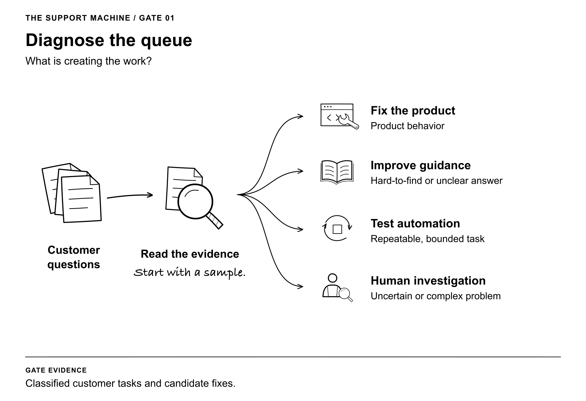
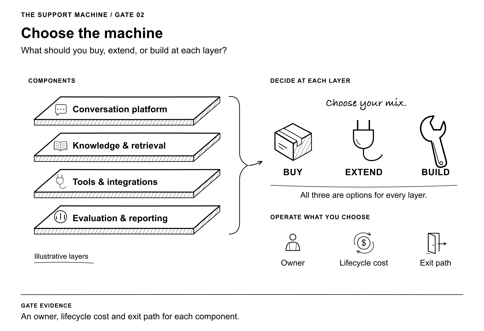
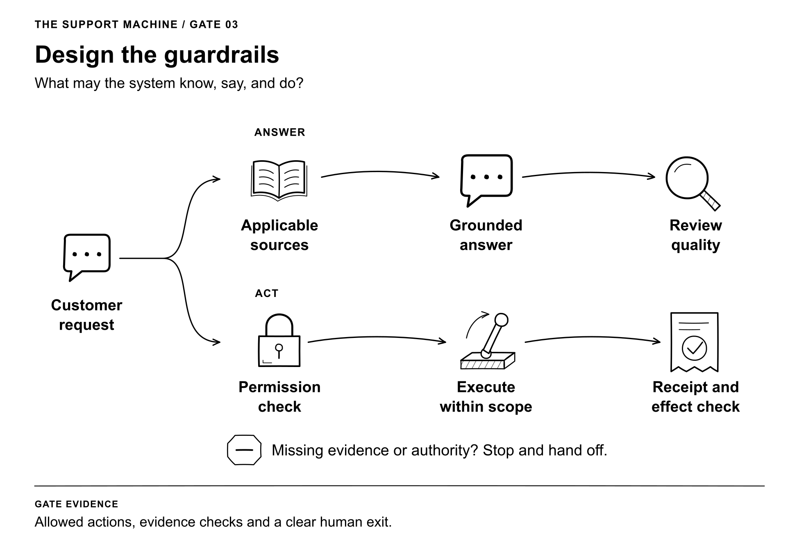
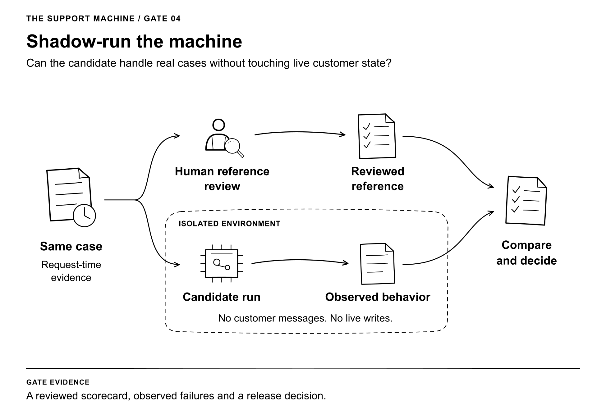
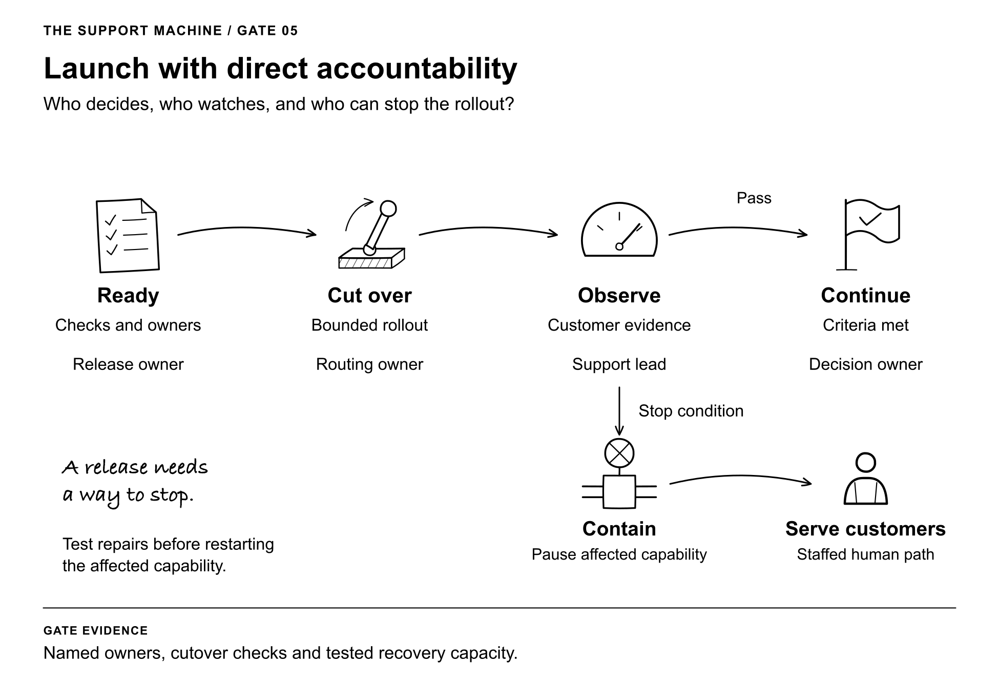
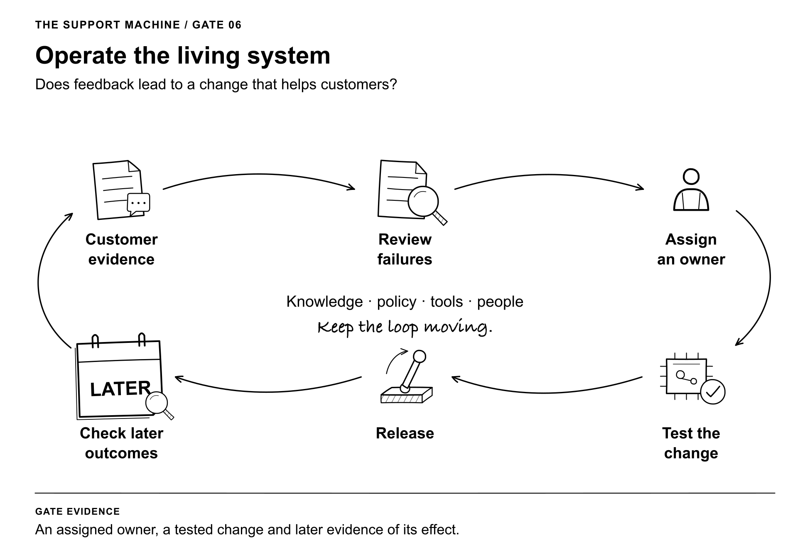
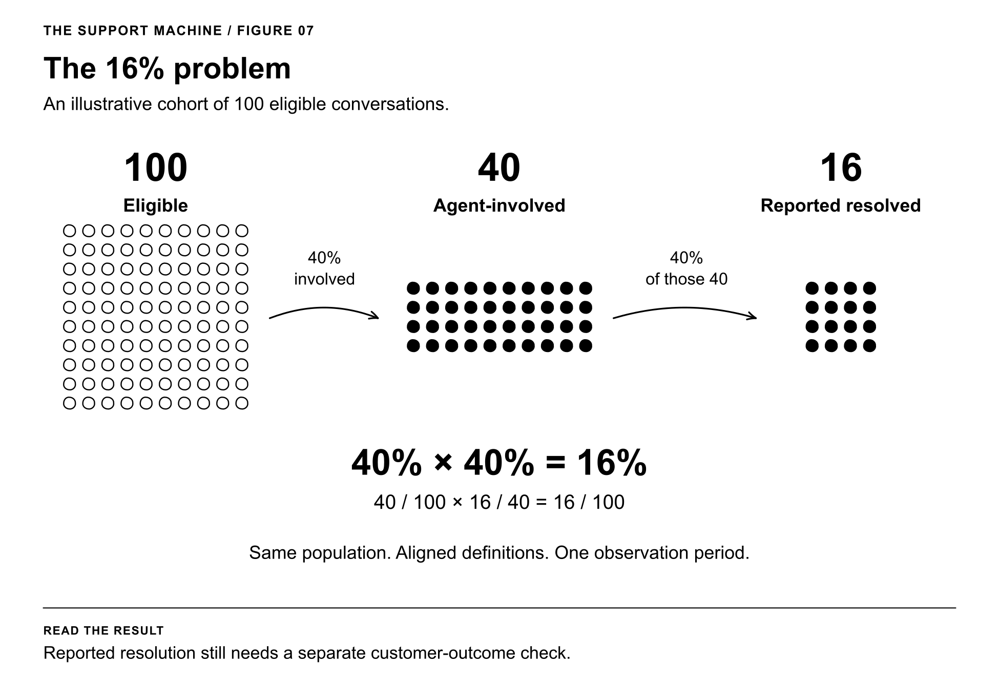
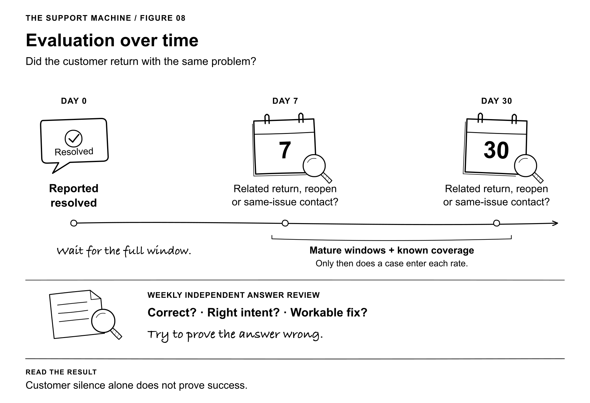
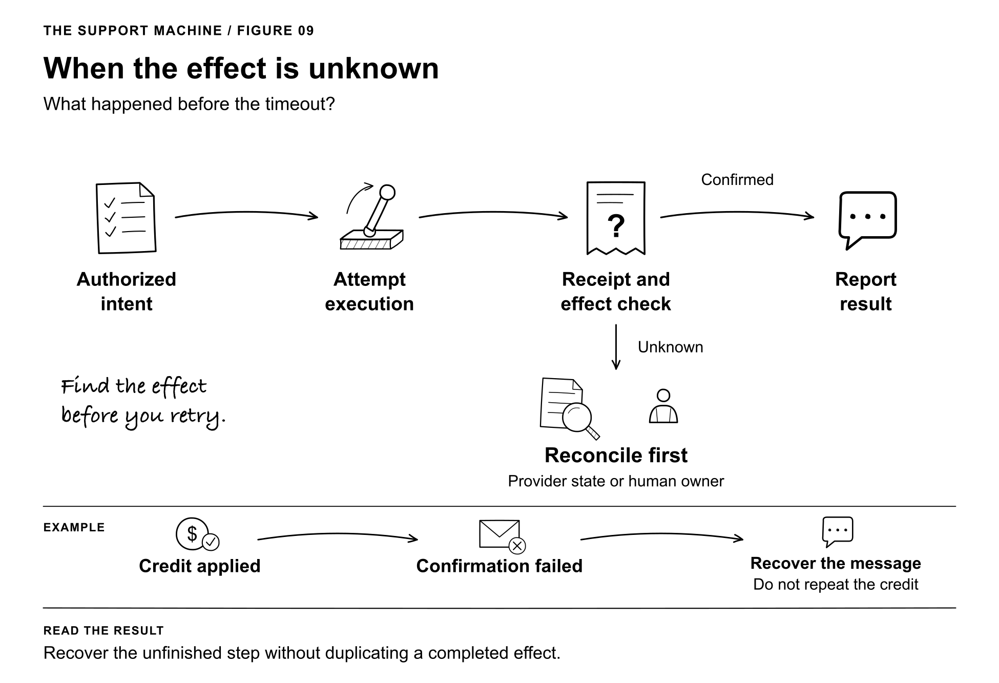
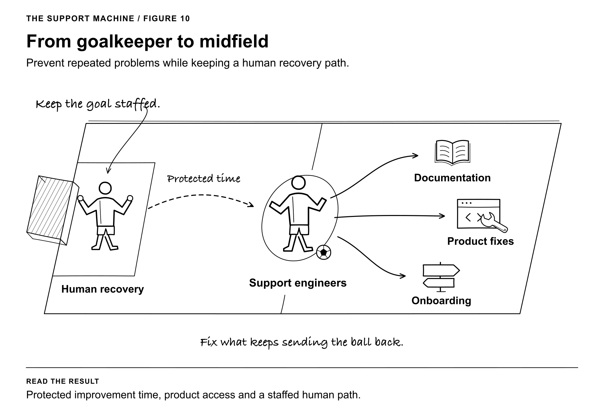

# The Support Machine illustrations

Ten companion drawings in a shared black-and-white architectural sketch style. Each appears beside its discussion in the Second Edition.

## Diagnose the queue

Read a sample of customer questions and distinguish product behavior, hard-to-find answers, repeatable tasks, and work needing human investigation.

[PNG](01-diagnose-the-queue.png) · [SVG](01-diagnose-the-queue.svg)

## Choose the machine

A support system has several layers. Buy, extend and build remain options at each layer; each component still needs funded operating ownership.

[PNG](02-choose-the-machine.png) · [SVG](02-choose-the-machine.svg)

## Design the guardrails

The answer path uses applicable evidence. The action path separately checks permission, executes, and verifies a receipt. Missing evidence or authority leads to a stop or human handoff.

[PNG](03-design-the-guardrails.png) · [SVG](03-design-the-guardrails.svg)

## Shadow-run the machine

Give a human reference review and an isolated candidate run the same request-time evidence. Compare the results; the candidate has no live messaging or write capability.

[PNG](04-shadow-run-the-machine.png) · [SVG](04-shadow-run-the-machine.svg)

## Launch with direct accountability

Readiness checks lead to a bounded cutover and observation. Evidence supports continuing; stop conditions route to containment and a staffed human service path.

[PNG](05-launch-with-accountability.png) · [SVG](05-launch-with-accountability.svg)

## Operate the living system

Customer evidence moves through review, an accountable owner, a tested change, release, and a later outcome check. The evidence feeds the next iteration.

[PNG](06-operate-the-living-system.png) · [SVG](06-operate-the-living-system.svg)

## The 16% problem

Of 100 eligible conversations, an agent is involved in 40. If 40 percent of those 40 are reported resolved, that is 16 of the original 100. These are illustrative counts, not company results.

[PNG](07-the-sixteen-percent-problem.png) · [SVG](07-the-sixteen-percent-problem.svg)

## Evaluation over time

Check related returns seven and thirty days after reported resolution. Each denominator needs a mature observation window and known coverage. Weekly independent answer review runs on a separate track.

[PNG](08-evaluation-over-time.png) · [SVG](08-evaluation-over-time.svg)

## When the effect is unknown

An authorized attempt can leave an uncertain effect. Inspect provider state or assign a human owner before deciding what to retry. If a credit succeeded but its confirmation failed, recover the message without issuing another credit.

[PNG](09-when-the-effect-is-unknown.png) · [SVG](09-when-the-effect-is-unknown.svg)

## From goalkeeper to midfield

Support engineers keep a staffed human recovery path and spend protected time improving documentation, product behavior and onboarding to prevent repeated customer problems.

[PNG](10-from-goalkeeper-to-midfield.png) · [SVG](10-from-goalkeeper-to-midfield.svg)
