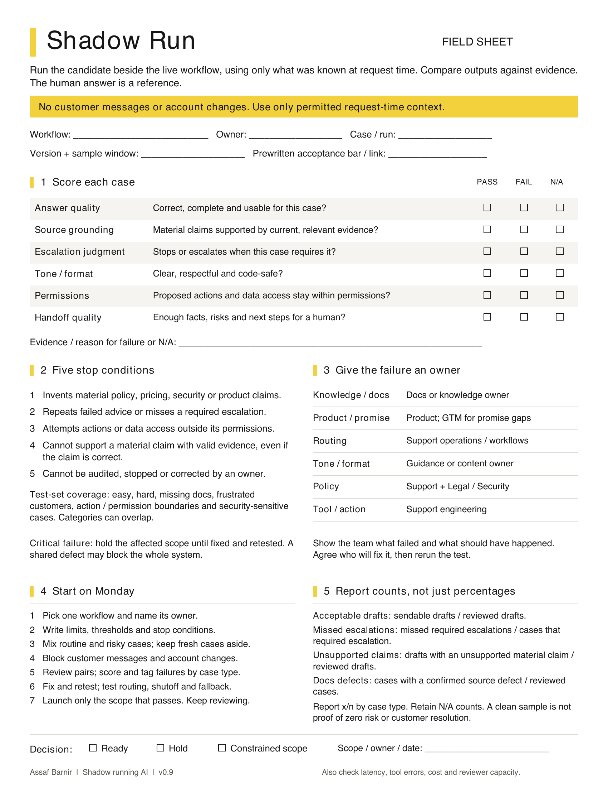

# Shadow Run field sheet

Before your AI touches customers. The one-page take-home from **[Shadow running AI: The framework for safer AI adoption](https://events.customersuccesscollective.com/location/supportsf/speaker/assafbarnir)** by Assaf Barnir.

**[Get the field sheet and see how to use it](https://assafbar2.github.io/the-support-machine/shadow-run/)**

## Download the PDF

**[Download the Shadow Run field sheet (PDF)](https://assafbar2.github.io/the-support-machine/shadow-run/Shadow-Run-Field-Sheet-v0.13.pdf)**

One printable page: six checks, five stop conditions, who fixes each failure, a plan for Monday, and compact metric definitions.

## Use it with your team

1. Pick one workflow and a person to run the test.
2. Write down what must pass and what stops a launch.
3. Include routine and risky cases. Keep some fresh.
4. Prevent the shadow agent from messaging customers or changing accounts.
5. Review the answers. Record failures and results.
6. Fix and retest. Test load, handoffs and the human fallback.
7. Start a small rollout of the work that passes. Keep reviewing.

The sheet records what happened inside the test. It does not prove customer resolution or zero risk.

## Book and templates

- [Read The Support Machine](https://assafbar2.github.io/the-support-machine/)
- [Chapter 22: The Shadow Run](https://assafbar2.github.io/the-support-machine/book.html#22-the-shadow-run)
- [Appendix B: Shadow Run and Change Release Record](https://assafbar2.github.io/the-support-machine/book.html#appendix-b-shadow-run-and-change-release-record)
- [Use the editable shadow-run scorecard](../../skills/the-support-machine/templates/shadow-run-scorecard.md)
- [Back to the repository](../../README.md)

Field sheet v0.13 from the talk. For the expanded release method, use Chapter 22 and Appendix B of the Second Edition.
