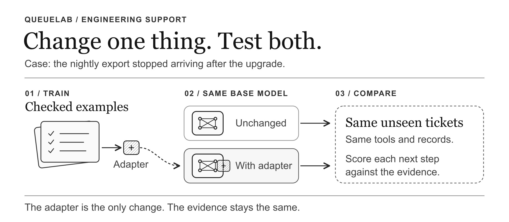

# QueueLab: proposed companion for The Shadow Run

Editorial draft for *The Support Machine — Second Edition*. The text below is ready to review in context. It does not revise the published printing or its downloads.

## Chapter 22 placement

Insert after **Build a set that can disappoint you**, before **Six checks for each case**. Use this as a short example of designing a test that can distinguish investigation from guessing.

### One ticket, three possible explanations

An engineering support ticket comes in: “Our nightly export stopped arriving after the upgrade.” You can write a convincing reply before you open a single record. You can't yet tell the customer what happened.

In one version of the case, the run log shows no export since the upgrade, and the schedule record shows it was turned off. Check the schedule before recommending that someone re-enable it. In a second version, the job completed. The receipt shows an old folder and the account record names a different one. Correcting the destination makes more sense than rerunning a job that worked. In a third version, the records have expired. Escalate with what you couldn't verify and what the next person should look for. It is the same opening message every time.

I built QueueLab to make that distinction measurable. The model can read fictional records, ask a bounded question, recommend a next step, or escalate. It cannot touch a customer account. If it guesses the schedule was disabled without finding evidence for it, the guess doesn't pass.

**Post-training** means training a model further after its initial training. Here I used fine-tuning: show the model a fictional investigation up to a particular point, then train it on the next action from a checked reference. Sometimes that action is another record lookup. Sometimes it is to stop and hand the case to a person. A prompt can tell the model to check first. Fine-tuning changes what it has learned to do.

I used **LoRA**, a way to leave the original model weights fixed while training a small add-on called an adapter. The habit I want to teach is checking whether the job ran before recommending a delivery fix. The account's current schedule still belongs in a record the model can look up, not in its weights.

*Figure: The missing-export case tests whether adding an adapter changes the next step the model can justify. The diagram explains the comparison, not its results.*

### Same test, two outcomes

I started with two already-trained language models. **SmolLM2 1.7B**, from Hugging Face, is a general instruction-following model. **Falcon-H1-Tiny 90M**, from the Technology Innovation Institute, is a much smaller model trained to request actions such as a record lookup. Those numbers are approximate counts of the settings learned by the original model. They aren't scores. I trained a separate adapter for each and compared each model with its own unchanged version. Same prompt, same tools, same 60 fictional test cases that neither adapter trained on.

SmolLM2 went from **0 to 53 evidence-backed decisions out of 60**. In one case, the unchanged model kept coming back to the run history. After training, it checked the delivery receipt, asked which folder the customer expected, and cited both destinations before recommending a correction. Unsupported recommendation attempts fell from 36 cases to seven. The improvement was still there when I accounted for the paired cases; it met the rule I had set before scoring.

Falcon learned to send more valid requests. It still gave advice the records couldn't support. It went from **0 to 3 supported decisions out of 60** and made unsupported recommendations in 39 cases after training. If I had graded the format, I could have called that a win. I wouldn't put my name on the advice.

This is what I want the shadow run to catch. Before you approve a model change, ask to see one investigation that got better and one that still went wrong. SmolLM2 still missed seven cases where the schedule was disabled. Neither run tells us whether a real customer got a file back. Those are fictional tickets from known failure families, not evidence of production outcomes.

## Appendix F placement

Add an entry under **Repositories Behind the Book**. Keep the link out of the printed text until the companion and the evidence it references are public.

### QueueLab

Read with Chapter 22, *The Shadow Run*. Start with the missing nightly export. Keep the complaint fixed, change the records, and see whether the recommended next step changes with them. A useful escalation counts when the available evidence cannot support a diagnosis.

The cases are fictional and the simulator is read-only. The recorded post-training comparison shows how an adapter helped SmolLM2 and why it didn't earn a pass for Falcon. Read the case traces alongside the scorecard. Neither the scripted replay nor the model tests establish customer outcomes.

## Editorial checks before publication

- Add the **QueueLab source and run record** link to Appendix F only when `https://github.com/assafbar2/queuelab` contains the approved release and readers can open it. Use `https://github.com/assafbar2/queuelab/tree/main/reports/post-training-2026-11-20` for the measured evidence and `https://assafbar2.github.io/queuelab/post-training/` for the replay after it is hosted. These are proposed destinations, not currently public reader links.
- The results above are from the actual November 20, 2026 local paired run. Don't substitute the scripted checklist's score or the animation's example numbers. Publish the traces and scorecard before treating them as linked evidence in the book.
- Keep Chapter 28 focused on ongoing evaluation. The primary placement for this example is Chapter 22; Appendix F holds the project and evidence links.
- For the LoRA explanation: [Hu et al., *LoRA: Low-Rank Adaptation of Large Language Models*](https://arxiv.org/abs/2106.09685). For publication, apply approved text to the canonical manuscript and regenerate the next printing without replacing the existing release.
